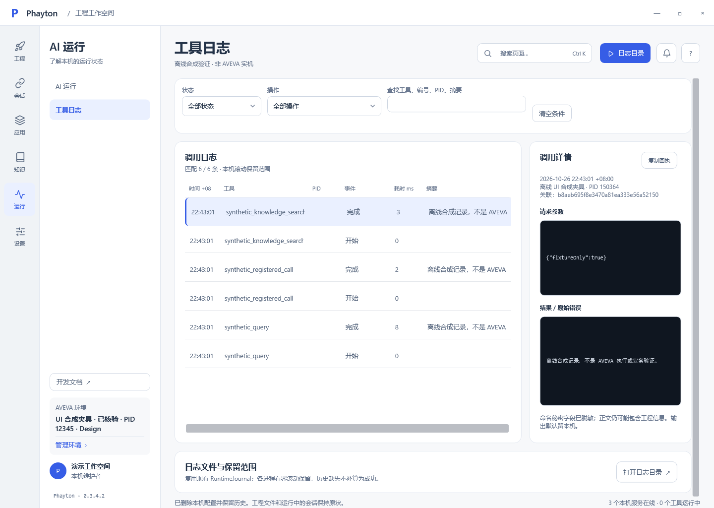

# Phayton

**让 AI 在 AVEVA 内部协助开发和三维核查。**

rewrite、Next 与 Ribbon/UIC 的源码、契约、测试、设计和作品集现已纳入 `integrations/`。换电脑请先读[单仓接手](docs/reference/portable-development.md)，运行 `./scripts/Test-IntegratedWorkspace.ps1`；作品集总入口为 `node scripts/Serve-IntegratedPortfolio.mjs`。不需要另行取得本机相邻项目。

当前平台集成候选的实现、验证边界与接手顺序见 [平台交接](openspec/changes/integrate-pmltwin-product-platform/features/platform-foundation-handoff.md)。管理器已有独立 CLI 和接同一后端的本机启动 HTML；Database 修订 DLL、函数入口、Ribbon HTTP 适配与 CAF 编译切片正在逐项融合，不能将这些切片视为完整 WPF/CAF 产品已交付。APS 启动及 Host/PML 实证见 [核验报告](docs/validation/cli-host-compatibility-2026-10-31.md)。

面向 E3D、AM / PDMS 的本机连接层与工作台：查资料、写 PML、备份部署、加载调试、回读结果；也可结合对象数据与视图追查问题和隐含关系。任务能力受平台、脚本与 AI 上下文约束，不承诺自动布管。

**≥5 位已知线上用户 · 数十人交流社群 · Apache-2.0**¹

[安装发行版](https://github.com/SoloLevelingAI/PmlTrigger.Yuzuha/releases) · [使用](docs/reference/workspace.md) · [规格与交接](docs/reference/specs/index.md) · [PRD / FigCraft](docs/reference/specs/PRD.md) · [CLI](docs/reference/cli.md)

管理器重构的当前审阅入口：[独立管理 CLI](docs/reference/manager-cli.md) · [按 Feature 拆分的 FigCraft 草稿](docs/design/yuzuha-manager-features/README.md) · [并行作品集验收与剩余门槛](docs/validation/portfolio-review-2026-10-30/README.md)。这组候选交付不代表新管理界面、完整安装包或产品实机验收已完成。



*图为正式 WPF 控件运行验证，使用隔离合成记录；未调用 AVEVA。*

| 任务 | 当前支持与边界 |
| --- | --- |
| 进入工程 | 安装发现、产品模块联动、组合筛选、差异预览、保存/重开、历史恢复、冲突保护；LaunchDesk 可选 |
| 开发工具 | 文件哈希计划、备份复制、REHASH、Object/Form 重载、验证宏与结果比对 |
| 协作核查 | 目标身份/协议核验、有界数据读取、原生窗体/控件查询、日志与未知结果核查 |
| 查阅资料 | 内置指南与本地知识检索已存在；默认官方 HTML/源码入口、个人补充及 PML 自动发现尚待闭合 |
| 自动化接入 | 原生 CLI 直接调用服务/Host；JSON inline/file/stdin、46 项操作、顺序 batch；独立 MCP 禁用 |

当前分支 **0.3.4.2** 的启动配置已接正式 WPF；评审/测试空壳和未接后端的浏览器演示已移除；未完成项集中在[待定清单](docs/reference/features/planned-tools.md)。分支版本不等于已发布安装包。E3D2.1 使用 2.1/NET48；E3D3.1 系列统一 3.1.6/NET48；AM/PDMS 使用 NET35。当前实机证据限 E3D2.1，其他产品须单独验证。大属性读取可能无响应，AM 发现及完整链路仍待实机验证。

写配置、启动、执行独立授权；超时/断线可能已执行，先核验、不自动重发。函数许可不是通用 PML 沙箱。凭据不进入配置历史或公开报告。

```powershell
.\runtime\cli\PmlTwin.Phayton.Cli.exe op list
.\runtime\cli\PmlTwin.Phayton.Cli.exe op describe launch.profile.save
.\runtime\cli\PmlTwin.Phayton.Cli.exe op invoke builtin.usage --input '{"query":"当前元素"}'
```

源码开发需要 Windows / .NET 10 SDK；Host 另需对应 AVEVA SDK。

```powershell
dotnet run --project src/YuzuhaToolkit.Desktop -c Release
npm ci
npm test
npm run docs:build
```

[安装](installer/INSTALL.md) · [开发加载](docs/reference/pml-development-flow.md) · [代码/JSON/TOML 测试](docs/reference/testing.md) · [本轮规格验证](docs/reference/specs/verification.md)

¹ 维护者提供的汇总，线下熟人不计；总用户数未知，社群人数不等于活跃用户数，不据此推算提效数据。

## English

Phayton connects AI to legacy AVEVA E3D, AM and PDMS through native CLI services and NET48/NET35 hosts. It supports PML development, deployment, inspection and traceable execution. Launch-profile persistence, history and recovery are implemented; unconnected browser demos and placeholder review/test pages were removed. Official-source defaults and automatic PML discovery remain planned. Standalone MCP servers are disabled. Live evidence currently covers E3D 2.1 only.
