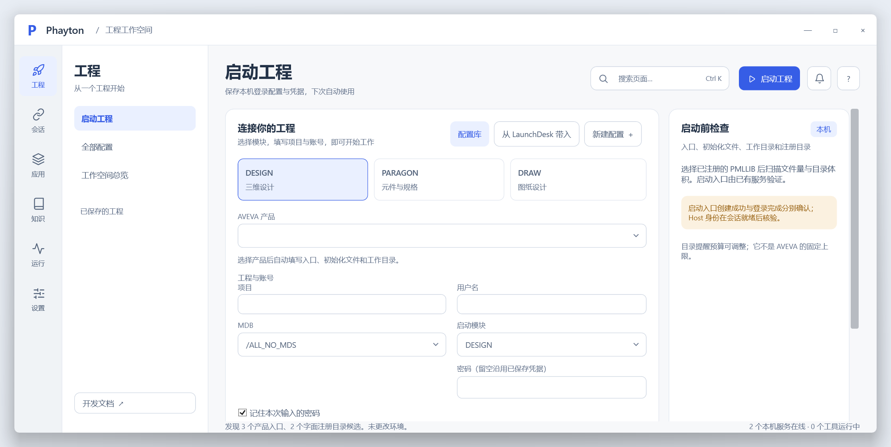
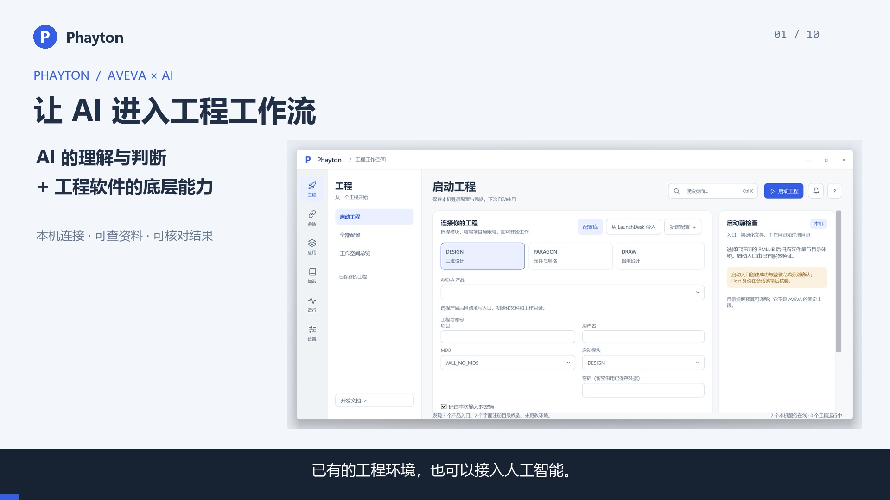
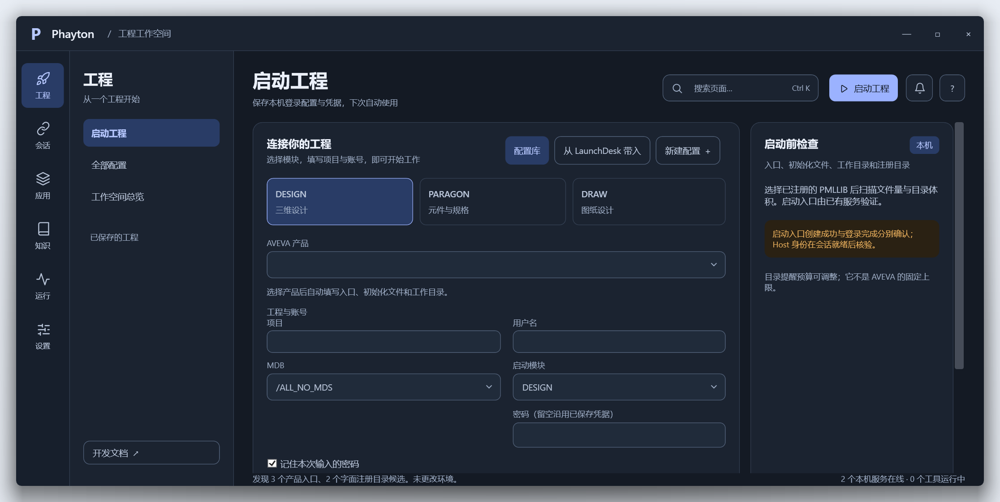
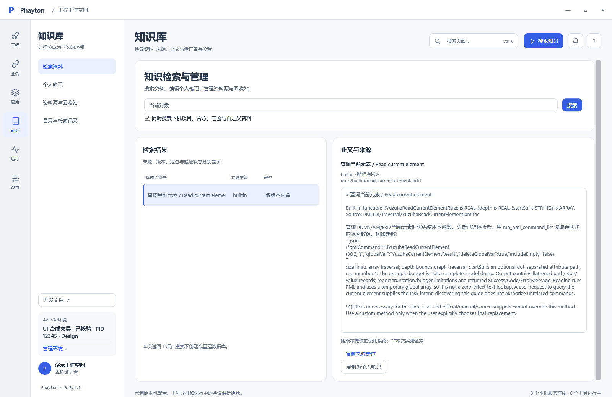

# Phayton

**把 AI 接入已有的工程工作流。**

Phayton 是面向 AVEVA E3D、AM / PDMS 的本机连接层与开发工作台。它把 AI 的理解与判断接到工程软件内部的 PML 能力：读取数据、查阅资料、执行授权操作并回传结果，让具体任务有一条可追溯的实施路线。

**至少 5 位已知线上用户 · 数十人的交流社群 · Apache-2.0 开源**¹

[观看演示](docs/media/Phayton-Workflow-zh-CN.mp4) · [演示章节与复刻](docs/reference/portfolio-demo.md) · [安装发行版](https://github.com/SoloLevelingAI/PmlTrigger.Yuzuha/releases) · [使用文档](docs/reference/workspace.md) · [English](#english)



*上图为 0.3.4.1 桌面源码发布后的实际运行截图，使用隔离的空配置。窗口外阴影由 Windows 绘制。*

## 一个连接层，两种工作方式

### 开发工具：把需求变成可复用的功能

描述需求 → AI 查资料并编写 PML → 预览与备份复制 → 加载 / 重载 → 读取结果 → 修正与再次验证。

函数、对象和原生窗体可以组合成一个小工具。Phayton 为加载和验证提供清楚的路径，留下文件版本、操作步骤与结果，方便继续改进。知识库与按功能、Script 组织的文档帮助 AI 和使用者理解已有能力。

### 直接协作：围绕数据与视图一起分析

AI 可以结合对象数据、视图与本地资料形成判断，通过 PML 继续核查，或执行用户授权的模型 / 视图操作。发现问题、追查不明显的对象关系，是这条路线的价值所在。

Phayton 提供连接、读取、执行与回传；分析质量还取决于 AI、上下文和 AVEVA 可提供的能力。具体任务需按环境验证，不能由“连接成功”推导为“任意工程任务自动完成”。[能力范围](docs/reference/runtime-capability-audit.md) · [Host 数据与截图记录](docs/session-recording.md)

## 看一个完整的小工具过程

[](docs/media/Phayton-Workflow-zh-CN.mp4)

演示围绕一个自有 PML 小工具：按钮调用函数和对象，显示结果与版本。内容包括新桌面实拍截图、源码演示，以及 **2026-10-23 E3D 2.1 实测记录重放**；没有把历史回执当成本次新执行。

| 环节 | 可查看的证据 |
| --- | --- |
| 写脚本 | [Function](tests/ai-pml/development-probe/YuzuhaDevAdd.pmlfnc) / [Object](tests/ai-pml/development-probe/YuzuhaDevData.pmlobj) / [Form](tests/ai-pml/development-probe/YuzuhaDevProbeForm.pmlfrm) / [验证宏](tests/ai-pml/development-probe/validate.pmlmac) |
| 加载 | 核验会话与 PMLLIB，备份复制，REHASH，重载 Object / Form |
| 调试 | 首次遇到 GADGET / MENU 类型不兼容，停止并保留回执，修正后独立重跑 |
| 验证 | 10 步通过、8 项结果匹配；Object / Form v1 → v2；真实按钮计数与 IPC 回读一致 |
| 复刻 | [操作说明](tests/live/pml-development/README.md) · [实测报告](docs/validation/2026-10-23-pml-development.md) · [公开结果摘要](docs/validation/2026-10-23-pml-development.summary.json) |

## 工作台里有什么

| 使用者要做的事 | Phayton 提供的支持 |
| --- | --- |
| 快速进入工程 | 保存工程启动配置与可选的本机凭据 |
| 确认连接是否可用 | 会话发现、目标身份核验、IPC 状态与运行记录 |
| 找到可用资料 | 随版本提供的内置指南；可选的本地知识检索与资料管理 |
| 让脚本真正加载起来 | 文件部署、备份、REHASH、Object / Form 重载与结果比对 |
| 查清调用出了什么问题 | 工具调用日志、关联编号、耗时和失败 / 未知结果 |
| 从常用 AI 工具接入 | CLI 与 MCP 两种入口，复用现有操作能力 |
| 管理函数调用 | 源码登记、版本哈希与独立调用许可；完整范围见下方说明 |

<details>
<summary>查看深色桌面与知识库界面</summary>





</details>

## 版本、安装与运行

仓库名仍为 `PmlTrigger.Yuzuha`，Phayton 是展示名称；既有可执行文件名、环境变量、CLI / MCP 标识和 PML 名称保留兼容。

- **下载使用：** 从 [Releases](https://github.com/SoloLevelingAI/PmlTrigger.Yuzuha/releases) 选择发行包，并按该包的 [安装说明](installer/INSTALL.md) 配置目标环境。预览版和开发分支的功能范围以各自说明为准。
- **本分支桌面：** `0.3.4.1` 修复窗口圆角、外阴影及最大化内容边界；[运行验证](docs/validation/2026-10-24-window-portfolio.md)对应本次源码构建。此版本号不表示 GitHub 已发布同版本完整安装器。
- **初次连接：** 先发现会话，再选择并核验目标。可先读取内置指南与少量数据，确认具体环境行为。

Windows 上从源码运行桌面（需要 .NET 10 SDK）：

```powershell
dotnet run --project src/YuzuhaToolkit.Desktop -c Release
```

已有安装中的 CLI / MCP 入口：

```powershell
.\YuzuhaToolkit.Mcp.exe --cli list
.\YuzuhaToolkit.Mcp.exe --cli call get_builtin_usage --arguments '{"query":"当前元素"}'
.\YuzuhaToolkit.Mcp.exe --mcp
```

多步 CLI 调用可以使用同一批处理保留会话。具体参数、返回值和退出码见 [CLI / MCP](docs/reference/cli.md)。

## 已验证范围

| 环境 / 能力 | 当前证据 |
| --- | --- |
| E3D 2.1 / NET48 | 已有会话记录、PML 部署重载、原生按钮与回读实测 |
| E3D 3.1.0 / 3.1.6、AM / PDMS / NET35 | 有对应 Host 配置和构建记录；不代表各版本均已实机验收 |
| 原生桌面 0.3.4.1 | Windows 11 本机实际窗口验证；14 页、两主题、三尺寸隔离回归 |
| 知识库 | 本地检索、资料管理、个人笔记与修订；用户资料及其本地索引不随公开发行包分发 |
| 函数权限 | 已登记版本的独立许可已实现；统一覆盖原始 PML、HTML、CLI / MCP 所有入口的模式仍在规划 |

大 ELDATA 回读的无响应、AM 发现与完整链路等问题仍按 [当前能力核对](docs/reference/runtime-capability-audit.md) 跟进。出现超时或结果未知时先查回执，不自动重复执行。原生命令入口可修改活动模型，函数许可不等于通用 PML 沙箱。

## 维护与贡献

用户带来具体问题，连接层与工具链围绕实际反馈改进。报告问题时提供版本、使用的 AVEVA 环境、最短操作与脱敏后的结果；工程数据、凭据与原始私有日志留在本机。[提交问题](https://github.com/SoloLevelingAI/PmlTrigger.Yuzuha/issues)

```powershell
npm ci
npm test
npm run docs:build
```

[功能与 Script 目录](docs/reference/catalog-maintenance.md) · [开发加载流程](docs/reference/pml-development-flow.md) · [架构](docs/reference/architecture.md) · [测试](docs/reference/testing.md) · [窗口实机检查脚本](scripts/Test-WindowFrame.ps1) · [演示素材与制作方式](docs/media/README.md)

```text
PMLLIB/ + PMLUI/   AVEVA 原生入口与脚本
src/              Framework Host、CLI / MCP、工作台与知识服务
tests/            离线回归、自有 PML 夹具与实测说明
docs/             功能文档、验证记录与可播放演示
scripts/          构建、部署、验证与视频制作
```

¹ 使用情况由维护者于 2026-10-23 提供：至少 5 位已知线上用户、数十人交流社群，线下熟人不计入。开源分发的实际总用户数未知；群成员数不等于活跃用户数，没有以此推算日活或提效比例。

## English

**Phayton connects AI to existing AVEVA engineering workflows.** It is a local connection layer and development workspace for E3D, AM and PDMS, with legacy NET35 / NET48 hosts and CLI / MCP access.

Two workflows share this foundation: **build reusable PML tools**, or **collaborate directly with AI using object data, views and local references** to investigate problems and verify actions. Domain-specific outcomes depend on the AI, available context and host capabilities.

The [video](docs/media/Phayton-Workflow-zh-CN.mp4) combines current desktop captures with a clearly dated replay of existing E3D 2.1 validation: deploy, reload, diagnose a type error, and verify the updated tool. [Evidence and reproduction](docs/reference/portfolio-demo.md). Compatibility, large-array limitations and permission boundaries are documented above.

## License

[Apache-2.0](LICENSE) · [Third-party notices](THIRD-PARTY.md) · [Security](SECURITY.md). AVEVA proprietary SDKs and user knowledge databases are not distributed.
