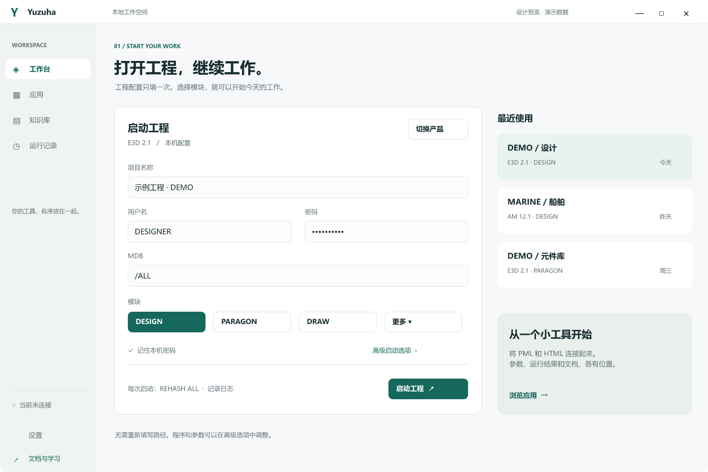
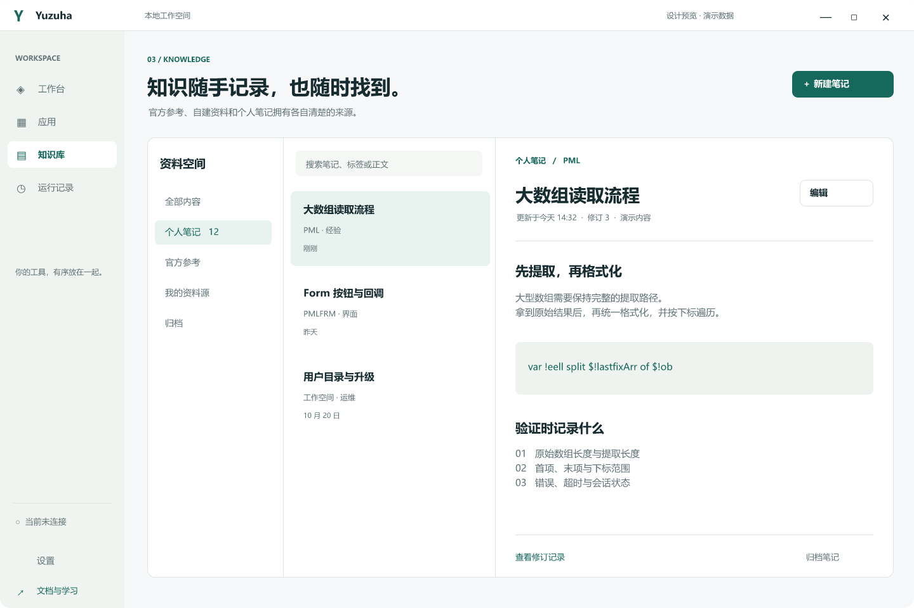
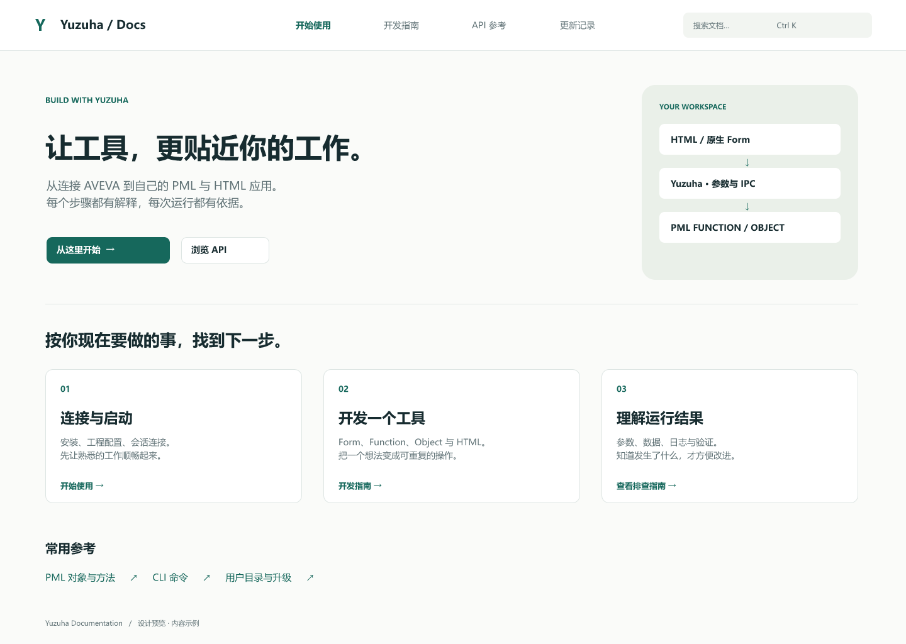
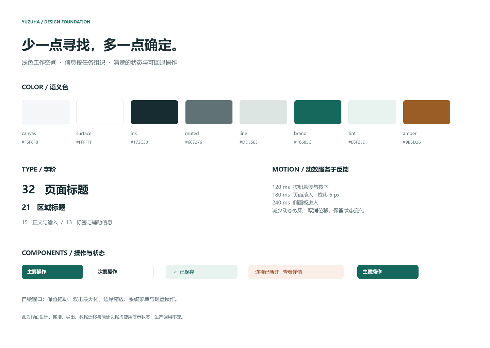

# Yuzuha Clear Workspace · R1

2026-10-23。用户选择先交付 FigCraft 设计与可操作预览；生产桌面、IPC、PML 调用与正式 DocFX 主题保持现有实现。本轮本机安装的是已验证的统一用户目录与知识库版本，界面改版单独评审。

[打开交互预览](prototype.html) · [设计与落地约定](../../reference/clear-workspace-design.md) · [安装及验证记录](../../validation/2026-10-23-installer-ui-preview.md)

原生源文件：`Yuzuha-Clear-Workspace-R1.figcraft`，可在仓库此目录下载后用 FigCraft 打开。保留之前的 `pmltwin-v08` 设计；本稿单独建档。

## 画板与设计系统

七个画板：启动工程、应用与结果、知识库、用户目录、DocFX 首页、DocFX 文章、组件与动效约定。8 个颜色变量、2 个带 Label 文本属性的按钮组件、1 个组件实例、2 个流程起点以及主导航链接。颜色变量见 [tokens.json](tokens.json)。

## 交互范围

`prototype.html` 是可直接打开的单文件版本，无外部资源依赖。可维护的 HTML/CSS/JavaScript 位于 `prototype/`。浏览器原型不执行 IPC，不读取用户目录，不使用真实凭据。笔记、目录设置、绑定及运行记录仅保存在页面内存，刷新恢复示例。CSV 导出只包含本页合成记录。

可操作：切换产品与模块、启动确认、按钮参数绑定、合成数组提取、分页/排序/筛选/CSV、笔记新建/编辑/历史/归档/恢复、目录切换预览、设置中的密码二次确认、减少动画、文档搜索与文章跳转。

应用登记和资料源管理展示入口/交互意图，没有接入真实登记后端。FigCraft 提供主要画板导航，完整表单状态操作在 HTML 预览中体验。效果检查以实际导出图片和浏览器操作为准，不将设计截图视为生产功能已实现。
