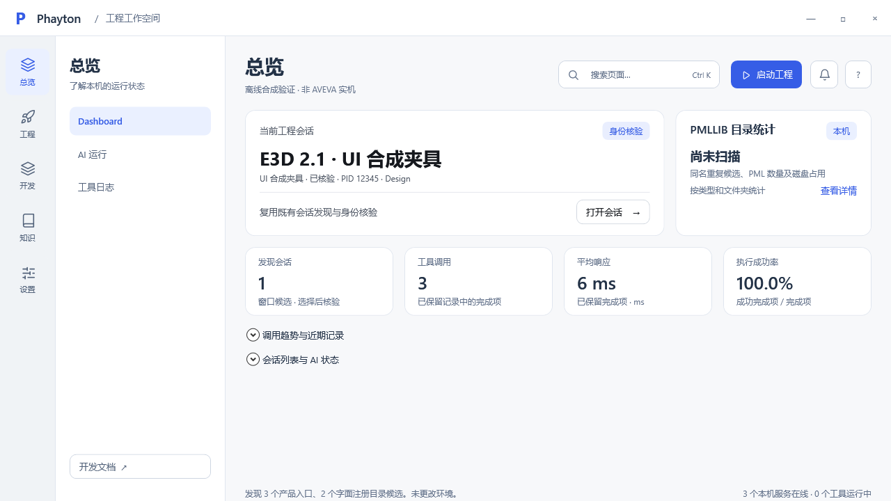

# Phayton R3 · 紧凑工作空间

当前导航修订：[预览](index.html) · [原生设计](Phayton-R3.figcraft) · [主题变量](tokens.css)。

WPF 主入口从六组收敛为五组，Dashboard 为首页。12 个现有功能视图作为组内任务保留，避免重复创建窗口和丢失草稿。原九份 Feature 与 R2 设计保留为历史详细资料；后续只维护此处的导航结构与对应 Feature 契约。

| 主入口 | 组内功能 |
| --- | --- |
| 总览 | Dashboard、AI 运行、工具日志 |
| 工程 | 启动、全部配置、连接与核验、函数、Form/Gadget |
| 开发 | Web 应用、PML 部署与验证 |
| 知识 | 检索、笔记、资料源与回收站、目录记录 |
| 设置 | 用户目录、环境路径、外观、凭据、AI 客户端、关于 |

原生稿仅一个画布页，含五个任务框和一个 853×480 首页变体，共五个 Light/Dark 颜色变量；全部文本和形状可编辑，30 个主导航原型跳转。CSS 从 FigCraft 变量导出。它是信息架构与变量基线，不是 WPF 的逐像素截图；各功能内部表单仍以 WPF 和既有 Feature 契约为准。

尺寸检查：1440×900 与 853×480 原生稿节点均在画板范围内；导出并检查 Dashboard 亮色、暗色、窄窗图。WPF 单独测试 1440×960、1280×720、853×480，前两档总览折叠态不需纵向滚动；窄窗和展开明细允许纵向滚动，不承诺长表单无滚动。总览的调用趋势、会话明细默认折叠；数据查询和校验逻辑不变。不能把本设计的示例状态当作实机回执。

定位源码：`src/YuzuhaToolkit.Desktop/MainWindow.Navigation.xaml.cs` 管主导航和可达性；`MainWindow.xaml.cs` 构造器在配置装载后选择首页；`MainWindow.xaml` 管摘要与折叠内容。`scripts/Test-Desktop.ps1` 保留 12 视图、双主题、3 尺寸与4失败状态检查；启动首页、五入口顺序、输入保留由内置隔离 smoke 断言。

## WPF 实现截图

隔离合成数据，不是 APS 实机：

