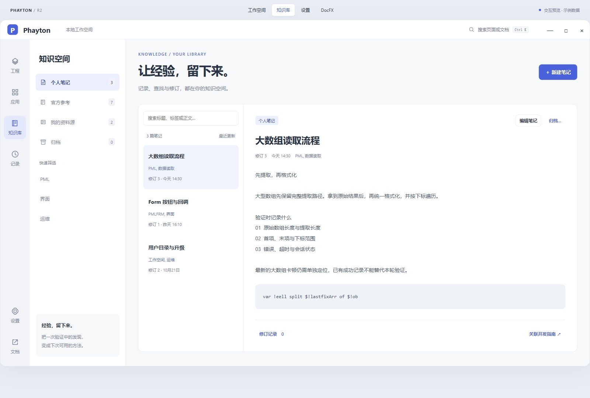
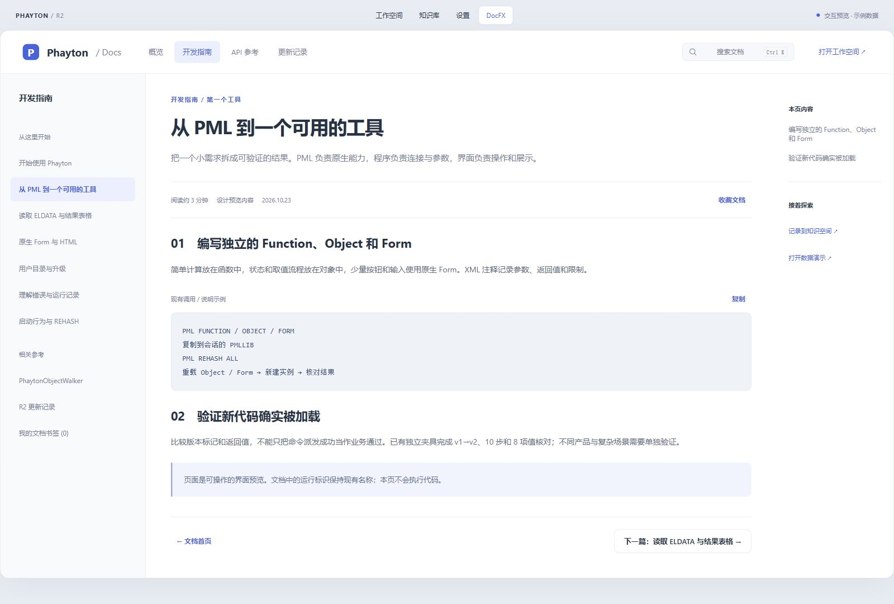
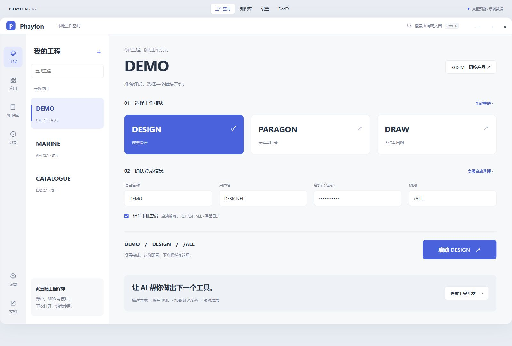

# Phayton R2 · 完整工作空间

对应 TRACE38，2026-10-23。[打开可操作原型](prototype.html) · [设计约定与操作路线](../../reference/phayton-r2.md)。

本目录为独立设计预览，不替换正式桌面或正式 DocFX 主题，不修改 PML、CLI、MCP、IPC 契约。展示名称统一为 Phayton。

`Phayton-R2.figcraft` 在独立 R2 页面中保存六个可编辑页面和组件约定板，保留既有历史页面；新增八个配色变量、两个按钮组件以及页面导航。HTML 承担表单编辑、检索、修订、确认、表格和失败状态等完整交互。

`style.css`、`app.js` 为可维护样式和交互源文件；`index.html` 与 `prototype.html` 为无外部依赖的单文件分发版，也供 DocFX 资源发布。

截图来自 1600px 宽浏览器实际页面。原生设计保留可编辑结构，字体渲染与浏览器略有差异；交互验收以 HTML 为准。演示资料只保存在页面内存，刷新即复位。
