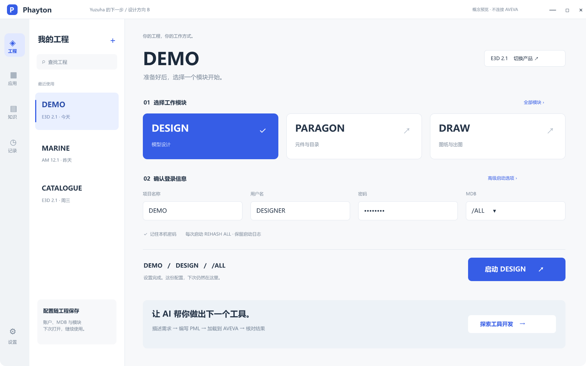
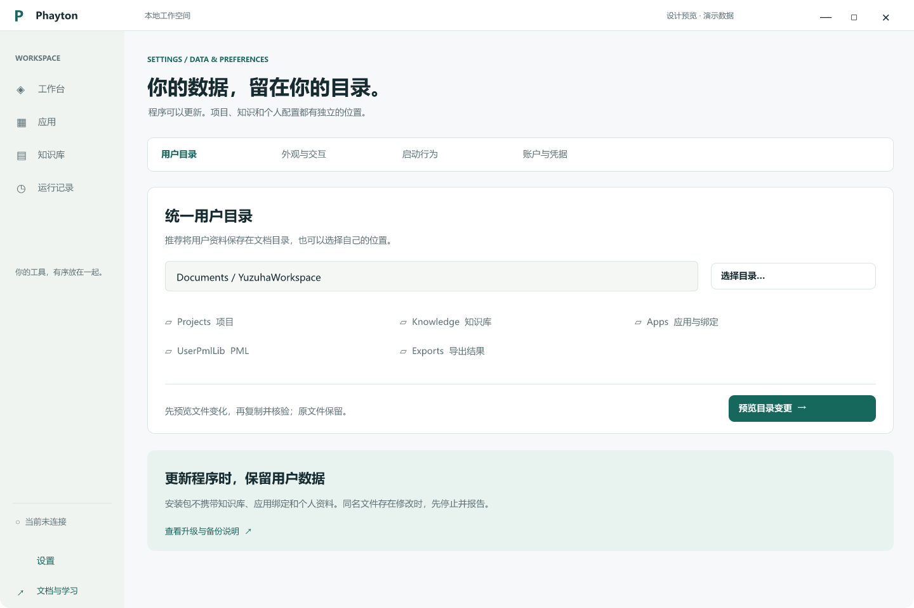
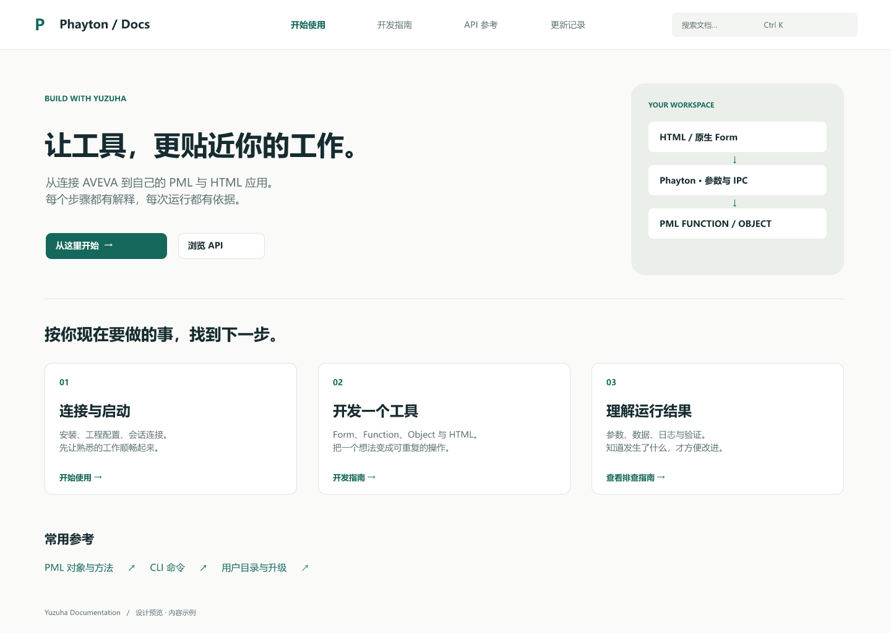

# Phayton 宽屏与工程工作空间评审

2026-10-23。设计与演示批次；现有调用和正式界面未替换。

[可操作原型](prototype.html) · [演示手册与名称过渡](../../reference/phayton-demo.md)

原生文件：`Phayton-R2.figcraft`。保留七个既有画板、变量、组件与链接，新增 1600×1000 工程工作空间方向稿；R2 启动页为静态概念，原型操作仍对应 R1.1。

