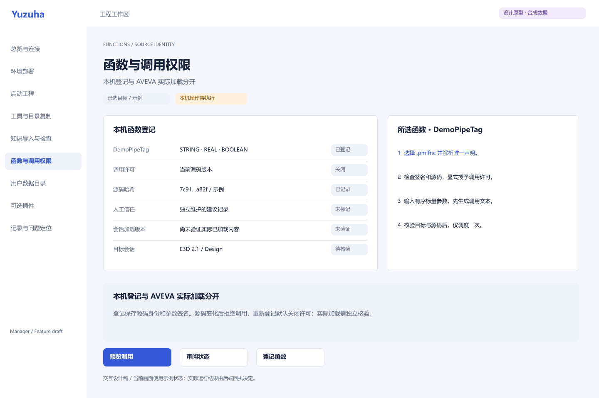

# Yuzuha 管理器 · Feature 设计

2026-10-30。由当前模型独立设计，FigCraft 串行生成；没有声称 DeepSeek 或 Zcode 认证成功。原有设计保留。本目录是可编辑设计草稿，WPF 新管理界面尚未完成。

[浏览设计索引](index.html) · [共用基础](00-design-system.figcraft) · [Tokens](tokens.json) · [独立验收](../../validation/portfolio-review-2026-10-30/README.md)

| Feature | 原生设计 | 独立交接 |
| --- | --- | --- |
| 总览与连接 | [01](01-overview-connections.figcraft) | [目标、灯态、过期](01-overview-connections.handoff.md) |
| 环境部署 | [02](02-deployment.figcraft) | [冻结预览与恢复](02-deployment.handoff.md) |
| 启动工程 | [03](03-launch-profiles.figcraft) | [配置与启动状态](03-launch-profiles.handoff.md) |
| 工具复制 | [04](04-tool-copy.figcraft) | [差异与条件恢复](04-tool-copy.handoff.md) |
| 知识导入检查 | [05](05-knowledge.figcraft) | [双路导入、版本隔离](05-knowledge.handoff.md) |
| 函数与权限 | [06](06-functions.figcraft) | [登记、签名、源码、调用](06-functions.handoff.md) |
| 用户目录 | [07](07-user-data.figcraft) | [迁移与资料保护](07-user-data.handoff.md) |
| 可选插件 | [08](08-plugins.figcraft) | [许可与 VM 隔离](08-plugins.handoff.md) |
| 记录与定位 | [09](09-records.figcraft) | [关联号、日志、unknown](09-records.handoff.md) |

每个 Feature 含浅色、深色、960px 窄窗和六类状态画板；函数 Feature 另有登记表单。文件保留原生文字、框架、两个按钮组件及其实例、16 个浅/深模式颜色变量和画板导航，没有把截图当作可编辑源。状态页和主画面之间有原型链接；参数编辑、表单校验及实际键盘行为须在实现后验证。

## 控制上下文

每次只加载一个 `.handoff.md`、对应 `source/features/<id>.json` 与 `tokens.json`。交接只回报改动、证据、未完成项；不要一次把全部设计送给模型。基础文件与颜色版本是共用来源，各 Feature 内保存同版本副本，当前不宣称跨文件实时联动。

只有一位 AI 操作 FigCraft；子 Agent 可并行只读验收代码、截图和交接材料。更新基础 tokens 后逐 Feature 审查；不要自动覆盖人工修改过的原生稿。

`source/build-features.mjs --feature=06-functions` 只更新该 Feature 的任务输入与交接，并保留其他索引项。没有参数时重建所有任务输入；实际保存和导出仍需运行 FigCraft CLI，生成脚本位于忽略的 artifacts/manager/design/features。

## 展示边界

当前画面都是明确标注的设计示例。真实 AM/E3D 连接、AVEVA 函数加载版本、实际许可 checkout、VM/VIX 动作与完整安装回退均未因此通过验收。函数登记/授权/调用已有旧 GUI 和通信 CLI 入口；新管理 CLI 的统一函数入口与统一记录页尚待整合。

