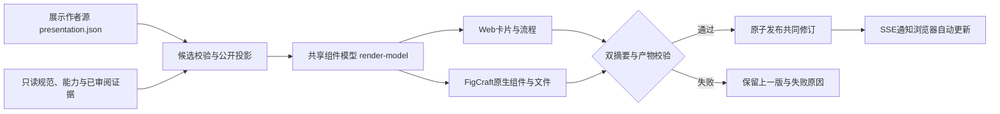

# 契约到组件：总体、Feature、Script与使用方式

## 总体契约

同一份作者数据生成同一份组件事实模型，Web与FigCraft分别负责布局。修改后自动生成，全部校验通过才发布共同修订；任一步失败继续显示上一版。工程生效规范仍是`docs/specification/contract.json`，验证事实由独立人工审阅的`docs/contracts/evidence.json`提取。展示作者源及编辑API均不能改写规范状态、实现状态或实机验证结论。

项目本身按“总体 → Feature → 内部Script → 回到总体”阅读，详见[项目总体契约](project-contract-overview.zh-CN.md)。本页说明这套展示如何持续生成；细化契约见[OpenSpec生成链](../../openspec/changes/integrate-pmltwin-product-platform/features/contract-generation-pipeline.md)。



## Feature责任

| Feature | 输入与交付 | 失败边界 |
|---|---|---|
| 作者编辑 | 已有实体白名单字段 → 候选预览或明确保存 | 原始文件摘要过期返回409，保留草稿；预览不写源 |
| 共享事实投影 | 公开metadata → 稳定ID的卡片、七字段、流程与视图绑定 | 引用、公开性、关键证据、字节或展开预算不通过即拒绝 |
| 自动生成与发布 | 数据变更 → 新Web快照及真实FigCraft文件 | 单写者、去抖、串行构建；失效结果不发布，旧文件不覆盖 |
| Web消费 | 已发布修订 → 自动更新卡片/步骤/连接/布局 | 校验摘要、模型与同源路径；断线保留旧图，重连补漏 |
| 设计工具适配 | 同一共享模型 → 原生主组件、实例、文字属性与变量 | FigCraft文件生成与外部画布刷新分开；Figma真实执行尚未验证 |

`variant=help/portfolio`、`density=compact/comfortable`、`orientation=horizontal/vertical`进入共享模型并影响两端呈现。项目指南与作品集共用事实；证据范围和排除项始终保留。文件编辑可配置完整流程；Web面板可编辑现有流程的steps/connections数组及已有视图props，不提供拖拽画布编辑器。

## 内部Script细化契约

| Script | 输入 | 前置 | 方法 | 副作用 | 校验 | 回执 | 恢复 |
|---|---|---|---|---|---|---|---|
| `contract-atlas-authoring.mjs` | 作者源、白名单changes | 已有实体、允许字段 | 纯函数生成新候选 | 无磁盘写入 | 字段身份及完整候选 | editable或候选对象 | 原对象不变 |
| `contract-atlas-metadata.mjs` | 明确来源、可选presentationOverride | 来源在仓内 | 提取、保真、公开投影 | CLI build写六份衍生产物 | 规范/引用/隐私/预算 | metadata及源指纹 | 失败不把候选当有效图 |
| `render-model.js` | metadata及metadataDigest | 公开schema通过 | 统一事实文本、七字段和绑定 | 无DOM、网络或文件写入 | 重建比对；2MiB metadata、8MiB IR | cards/flows/viewBindings | 超限拒绝，不删事实 |
| `contract-atlas-pipeline.mjs` | 数据指纹、冻结模型、tokens | 输出目录单写者租约 | 新staging、原生构建、最终复验、切指针 | 写自有修订；显式save写作者源 | 新建/缓存均复验源与代码 | manifest/current及状态 | lastgood、失效重建、失败显式重试 |
| `build-contract-atlas-design.mjs` | 冻结metadata/IR/tokens与新目录 | CLI存在、目录未存在 | 异步生成原生节点并结构校验 | 仅写新目录 | 双摘要、实例文字及真实连接 | 原生文件与哈希回执 | 失败保留本次诊断及旧稿 |
| `live-client.js` / `editor.js` | SSE修订、作者草稿 | 本机同源、写入需token | 拉取复验、保留阅读状态、预览后明确保存 | 更新Web；save经API写源 | 实例/序号/摘要/CAS | 已发布或明确draft/import | 草稿暂停覆盖；冲突/响应不明不自动重发 |

## 操作与汇总

在仓库根启动：

```powershell
node scripts/serve-contract-atlas.mjs --watch --edit --port 19439
```

打开终端打印的本机网址。点击“编辑展示字段”，选择字段并修改，先“校验并预览草稿”，再“明确保存并生成共同版本”。也可直接修改`docs/contracts/presentation.json`：无需再执行build或刷新页面，服务会自动生成共同版本。界面显示生成阶段、当前修订及双摘要，可下载该版本的FigCraft文件。`--watch`不带`--edit`时仍自动生成并允许明确重试，但不开放作者保存；无watch是静态离线预览。

例如选择`feature / feature:ribbon / title`修改卡片标题；选择`script / script:ui-pending-gate / contract.method`修改公开七字段；选择`flow / flow:ribbon / connections`编辑完整连接数组；选择`view / view:ribbon / props`填写`{"density":"compact","orientation":"vertical"}`。未知属性及隐藏状态/证据被拒绝。

失效输入、工具失败和409都会显示原因。未保存草稿或独立JSON导入暂停实时覆盖，处理后可明确返回共同版本；保存受理不等于生成完成。保存核对以发布manifest的作者源摘要为准，其他依赖在预览后变化仍能完成。失败后可明确“结束本地核对”，返回已发布图再加载当前作者基线修正；该操作不回滚已保存源、不撤销构建、不重发原请求。渲染器代码变更须重启服务；数据和tokens变更自动处理。异常退出留下租约时，核对记录的PID后处理，或用`--output-dir artifacts/another-atlas`选择新目录；程序不会自行抢占。

```powershell
npm run contracts:test
npm run contracts:browser
npm run contracts:themes
npm run contracts:live
```

最后一项必须使用真实FigCraft CLI与已有Playwright/Chromium，缺工具直接失败，不以mock充当证明。端到端在隔离源副本中验证文件修改、Web作者保存、失败保留和重连，原始项目作者源保持不变。所需工具路径、单次设计生成及Figma导入限制分别见[Web组件说明](../presentation/contract-atlas/README.md)和[原生适配说明](../design/contract-atlas/README.md)。

共同修订意味着Web和生成的FigCraft文件使用相同数据与模型；已经打开的FigCraft编辑器仍需手动打开新文件。此链路用于项目理解和作品集，不把静态图升级成新的工程实机验收。
