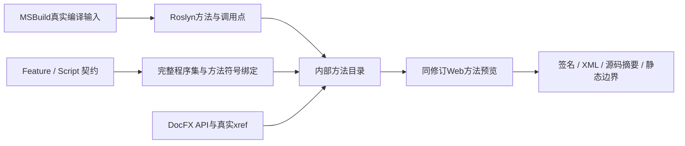

# 从契约预览方法：总体、Feature与Script

## 总体契约

契约图谱可进入明确绑定的C#方法，查看签名、XML说明、带来源摘要的源码快照、直接静态调用关系，并打开精确DocFX成员。工程规范、实现状态和运行验证仍分别保留：源码里存在一条调用，不表示调用实际发生或测试已覆盖。



方法目录独立于公开metadata与组件事实模型。只在本机共同生成服务读取；公开SVG和FigCraft不会因打开方法预览自动带出原始C#。生成文件位于共同修订的`method-catalog.json`，与公开metadata、IR双摘要及独立方法摘要绑定。

## Feature责任

| 层 | 负责什么 | 明确边界 |
|---|---|---|
| 契约绑定 | `docs/contracts/method-bindings.json`将稳定entityId映射到完整`Assembly::DocumentationCommentId` | 不按标题、短名或相似文件猜测实现 |
| Roslyn分析 | 真实Compile、引用及条件编译输入；重载、泛型、partial、async、源码调用点 | 候选实现、委托、RPC对应保持静态标签；不拼接进程内执行链 |
| 方法目录 | 保留签名、XML、partial位置、文件SHA256、有界正文、直接邻域与排除范围 | 生成/SDK/外部声明没有手写正文；邻域之外不宣称零调用 |
| DocFX快照 | 首期Manager.Core与Workspace两项目API；从xref精确解析成员href和锚点 | private或范围外成员可预览源码，但API链接明确不可用 |
| Web预览 | 同页选方法、看直接调用方/下游、回到契约；保留阅读、筛选、流程和方法hash | 只读，不执行选中方法；源码和XML只按纯文本渲染 |

方法使用完整符号区分重载；不把async改成编译器状态机的执行关系。partial同时列出声明和实现，正文取实现。匿名函数按源码位置标识，源码编辑后身份可能变化，不能把它当长期业务ID。

## 内部Script七项细约

| Script | 输入 | 前置 | 方法 | 副作用 | 校验 | 回执 | 恢复 |
|---|---|---|---|---|---|---|---|
| `Trace-Desktop.ps1` | 仓库项目与.NET工具链 | 编译输入可解析 | MSBuild捕获后由Roslyn分析 | 仅开发构建与自有分析产物 | 配置/源码前后摘要、语义编译诊断 | graph及编译输入/producer身份 | 失败不把残缺图当新快照 |
| `UiTrace.cs` | 实际sources/references/defines | 语义编译无错误 | 符号、XML、声明、调用点和静态边界 | 写指定graph | 原DocID、partial/async与源码范围 | 版本3静态关系图 | 不确定目标保持边界，不猜同名替代 |
| `capture-contract-atlas-docfx.mjs` | 两项目实际输入 | 已恢复DocFX工具 | 新目录metadata/build与xref产物核验 | 写独立API站点及成功指针 | 输入前后SHA、资源字节与清单 | snapshot.json | 失败保留上次成功站点 |
| `contract-atlas-methods.mjs` | 图、绑定、来源与DocFX快照 | 路径/预算/实体有效 | 有界方法投影与精确xref解析 | 无业务动作 | 图、源、producer、DocFX输入和双摘要 | 内部catalog及受管资源 | 缺失显式unavailable，过期隐藏正文 |
| `contract-atlas-pipeline.mjs` | 公开图与方法输入指纹 | 单写者协调者 | staging、共同验证、原子发布 | 自有修订目录 | metadata/IR/method三摘要及最终源复验 | 同修订manifest | 失败保留lastgood |
| `method-panel.js` | 已校验目录与明确方法ID | 共同修订已应用 | 展示签名/XML/正文与直接边 | 仅本地阅读状态 | 绑定、URL清单与纯文本 | 可复制的方法身份与来源 | 删去的方法清选择；草稿/导入隔离绑定 |

完整分析graph上限96MiB，完整编译输入receipt最多1024个仓内文件；手写预览源最多512个。发布目录最多500方法、1500条保留调用位置的关系、8MiB JSON。单方法正文最多64KiB，截断会明确标记；来源范围和完整文件摘要仍保留。

## 使用与汇总

先显式捕获，再运行图谱服务：

```powershell
. ./scripts/Use-YuzuhaDotnet.ps1
npm run contracts:methods:capture
node scripts/serve-contract-atlas.mjs --watch --edit --port 19439
```

捕获命令先恢复仓库钉定的DocFX工具，再获取实际Roslyn输入与独立API站点；不会运行完整文档流水线或启动DevHost。生成成功后，已有watch服务自动发布新的方法目录。新电脑需安装`global.json`指定的.NET SDK（当前为10.0.302、latestPatch），可用上面的脚本选择已安装SDK，不依赖原机器的工具路径。浏览器验证先运行`npm ci`与`npm run contracts:browsers:install`，使用锁定的Playwright及其管理的Chromium；显式浏览器路径可由`CONTRACT_ATLAS_CHROMIUM_EXE`覆盖。

`artifacts/`中的Roslyn编译输入、DocFX站点及共同修订均为本机捕获产物，不随Git提交，也不应复制另一台机器的绝对编译输入重放。独立克隆可先直接运行`npm run contracts:styles:serve`阅读公共契约；方法显示未生成时，按上述步骤在新机器显式捕获并完成共同发布。

在“工程发现与启动”或“启动生命周期”等已绑定Feature/Script详情点击“查看实现方法（N）”，即可定位方法面板并聚焦方法。展开“手写源码快照”看正文，“直接调用方／直接下游”按调用位置导航；“打开同修订DocFX成员”进入真实API页面。URL hash保留方法及方向，切主题或阅读视图不更换方法。

| 状态 | 含义与下一步 |
|---|---|
| unavailable | 尚未捕获分析或所需范围不存在；显式运行捕获命令 |
| stale | 源码、编译配置或分析器变化；停止显示旧正文，重新捕获 |
| ready但无DocFX链接 | private、范围外、精确UID缺失，或站点源码receipt已过期；保留原因，不猜锚点 |
| 未登记方法 | 没有明确映射，或该Script是PML/PowerShell等其他语言；不等于没有实现 |
| 生成失败 | 原共同修订仍可阅读；检查错误/绑定与快照，再明确重试 |

源码修改不会隐式触发全量MSBuild。watch先发布过期状态；重新捕获后显示新源码。若只更新Roslyn而DocFX站点仍旧，方法正文可恢复，旧DocFX链接继续不可用，直到重新生成站点。

```powershell
npm run contracts:test
npm run contracts:methods:browser
npm run contracts:methods:live
```

最后一项使用真实Roslyn、真实DocFX站点、FigCraft共同生成与Chromium；它在隔离副本修改源码、重放已捕获的实际编译输入并检查过期/恢复，不修改原工程源码或运行业务动作。Web消费者夹具与真实生产者验收分别记录。

方法身份和partial位置遵循Microsoft的[IMethodSymbol说明](https://learn.microsoft.com/dotnet/api/microsoft.codeanalysis.imethodsymbol)，成员链接依据DocFX实际[xref映射](https://dotnet.github.io/docfx/docs/links-and-cross-references.html)。更完整的编译范围与动态调用限制见[静态UI溯源说明](ui-tracing.md)；方法预览保持同样的静态证据边界。
