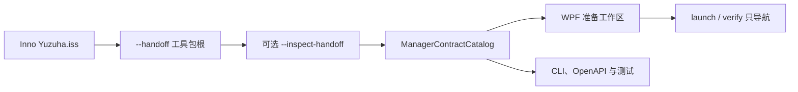

# 设计、契约与脚本追踪

2026-11-02。基线是 PR #13 头 `bb52df4`。本页跟踪其后的契约收口，不把源码测试写成实机通过。

## 结论

安装到工程操作现在只有一条运行时契约：`ManagerContractCatalog` 导出旅程、21 项公开摘要和退出码表，准备页、CLI 与文档都读它。提案里的逻辑名称留在 `pmltwin.platform-proposal/0.2`，不能当成已注册操作。`OperationResult.data` 仍是未知 JSON；公开摘要允许额外字段。写入、启动和执行仍要显式授权，未知结果不自动重试。27.10 与 27.16 继续开着，因为它们要实机和人。

## 状态总览

| 评审项 | 状态 | 证据 |
|---|---|---|
| 1. 提案契约与已注册 ID 对齐，并勾上任务 1.3 | 已修复 | [提案](../../openspec/changes/integrate-pmltwin-product-platform/contracts.md) · [测试](../../tests/YuzuhaToolkit.Manager.Tests/PlatformProposalContractTests.cs#L11) |
| 2. 为 21 项旅程操作补公开摘要，`data` 仍为未知 JSON | 已修复 | [摘要目录](../../src/YuzuhaToolkit.Manager.Core/JourneyOutputProjections.cs#L29) · [漂移测试](../../tests/YuzuhaToolkit.Manager.Tests/JourneyOutputProjectionTests.cs#L13) |
| 3. 安装器退出码 10 与管理器 7 / `error.Code` 写入同一张表 | 已修复 | [对照表](../../src/YuzuhaToolkit.Manager.Core/InstallExitTaxonomy.cs#L16) · [指南表](../reference/install-to-operation.zh-CN.md#L266) |
| 4. 准备页 Host profile 改由 `ManagerHostProfiles` 提供 | 已修复 | [唯一清单](../../src/YuzuhaToolkit.Manager.Core/ManagerHostProfiles.cs#L14) · [界面绑定](../../src/YuzuhaToolkit.Desktop/PreparationWorkbenchView.xaml.cs#L44) |
| 5. 交接可只读核验；launch / verify 只导航 | 已修复 | [旅程 §6](../../openspec/changes/integrate-pmltwin-product-platform/features/install-to-operation-journey.md#L45) · [安装器参数](../../installer/Yuzuha.iss#L70) |
| 6. OpenSpec 入口、同步政策和审查基线 | 已修复 | [审查入口](../../openspec/README.md#L5) · [第 6 节](#6-openspec-入口与同步政策) |
| 7. 准备页中英文与可访问名称 | 已修复 | [准备页文案](../../src/YuzuhaToolkit.Desktop/PreparationWorkbenchView.xaml#L31) |
| 8. 任务 27.10 与 27.16 的实机、人工步骤 | 保持开放 | [27.10](../../openspec/changes/integrate-pmltwin-product-platform/tasks.md#L286) · [27.16](../../openspec/changes/integrate-pmltwin-product-platform/tasks.md#L292) |

## 端到端链路

只读核验停在 `setup.handoff.inspect`。准备页的启动和核验阶段只换页。真正的写入、启动和连接仍走已注册操作，并要求单独授权。

## 1. 提案名称留在提案里

任务 1.3 要求把 [contracts.md](../../openspec/changes/integrate-pmltwin-product-platform/contracts.md) 收成版本化 schema 和兼容样例，并让新逻辑名称不冒充已注册操作。运行时身份仍以旅程契约为准，见 [install-to-operation-journey.md](../../openspec/changes/integrate-pmltwin-product-platform/features/install-to-operation-journey.md) 的契约节。

| 环节 | 落点 |
|---|---|
| 设计意图 | 任务 [1.3](../../openspec/changes/integrate-pmltwin-product-platform/tasks.md#L9) |
| 契约条目 | `pmltwin.platform-proposal/0.2`，[contracts.proposal.json](../../openspec/changes/integrate-pmltwin-product-platform/contracts.proposal.json) |
| 实现位置 | 已注册 ID 只由 [ManagerContractCatalog.Export](../../src/YuzuhaToolkit.Manager.Core/ManagerContractCatalog.cs#L76) 导出 |
| 测试证据 | [PlatformProposalContractTests](../../tests/YuzuhaToolkit.Manager.Tests/PlatformProposalContractTests.cs#L11) 对照实际目录 |
| 剩余缺口 | `OperationPlan`、`DatabaseSession`、`DesignHandoff` 仍是提案，没有注册成操作 |

`feature.list`、`environment.discover`、`launch.plan` 和 `setup.handoff.inspect` 已注册。`feature.describe` 与 `environment.check` 仍未注册。

## 2. 公开摘要与未知 data 并存

旅程契约第 5 节要求缺少专用 schema 时保留 `OperationResult.data` 为未知 JSON，同时不伪造封闭类型。这次为 21 项旅程操作增加公开摘要，摘要必须允许额外字段。

| 环节 | 落点 |
|---|---|
| 设计意图 | [旅程契约第 5 节](../../openspec/changes/integrate-pmltwin-product-platform/features/install-to-operation-journey.md#L39) |
| 契约条目 | 导出字段 `outputProjections`；边界文字仍写 unknown JSON，见 [L83](../../src/YuzuhaToolkit.Manager.Core/ManagerContractCatalog.cs#L83) |
| 实现位置 | [JourneyOutputProjections.For](../../src/YuzuhaToolkit.Manager.Core/JourneyOutputProjections.cs#L29) 按旅程 ID 生成，不另存一份清单 |
| 测试证据 | [SummariesMatchRealPayloads](../../tests/YuzuhaToolkit.Manager.Tests/JourneyOutputProjectionTests.cs#L13) 用真实 DTO 序列化结果核对必填字段，并确认额外字段仍可通过 |
| 剩余缺口 | `connection.sessions` 是通信 CLI 透传，[L136](../../src/YuzuhaToolkit.Manager.Core/JourneyOutputProjections.cs#L136) 不承诺字段 |

成功回执的摘要例子：交接核验给出包根、模式和哈希；预览与应用给出 `planId` / `kind` / `sha256` / `summary`。失败数据可以缺席或带诊断，不因此把整个 `data` 收死。

## 3. 两个进程的退出码

旅程契约第 6 节规定安装器 apply 失败和管理器处理器失败分开记录。数值保持原样，避免改掉已有 CLI 行为。

| 环节 | 落点 |
|---|---|
| 设计意图 | [旅程契约第 6 节](../../openspec/changes/integrate-pmltwin-product-platform/features/install-to-operation-journey.md#L51) |
| 契约条目 | [InstallExitTaxonomy.Rows](../../src/YuzuhaToolkit.Manager.Core/InstallExitTaxonomy.cs#L27)，并写入导出的 `exitTaxonomy` |
| 实现位置 | 安装器 [FailureCode := 10](../../installer/Yuzuha.iss#L217)；部署、EVARS、交接和启动改用 `ManagerHandlerExit` 与 `ManagerConfigurationExit` |
| 测试证据 | [InstallerScriptAndHostProfilesUseTheSameTables](../../tests/YuzuhaToolkit.Manager.Tests/JourneyOutputProjectionTests.cs#L57) 读取 `.iss`，核对 10 与 `INSTALL_APPLY_FAILED` |
| 剩余缺口 | 无。表中每一行 `autoRetry` 都是 false |

安装器进程的 10 是 `INSTALL_APPLY_FAILED`。管理器进程的 7 沿用 `TransportFailed`，具体原因在 `error.Code`。管理器进程的 10 是 `CONFIGURATION_CONFLICT`。生成指南里的表在 [install-to-operation.zh-CN.md](../reference/install-to-operation.zh-CN.md#L266)。

## 4. Host profile 只有一份清单

旅程预览阶段已经要求用 `ManagerHostProfiles.Framework` 拒绝产品与 Host 错配。准备页以前自己写了 E3D 2.1、E3D 3.1.6、AM、PDMS。

| 环节 | 落点 |
|---|---|
| 设计意图 | [旅程契约第 2 节](../../openspec/changes/integrate-pmltwin-product-platform/features/install-to-operation-journey.md#L17) 的 profile / framework 输入 |
| 契约条目 | [ManagerHostProfiles.All](../../src/YuzuhaToolkit.Manager.Core/ManagerHostProfiles.cs#L14) |
| 实现位置 | 下拉框绑定该清单，[L44](../../src/YuzuhaToolkit.Desktop/PreparationWorkbenchView.xaml.cs#L44)；候选版本用 [ProfileFor](../../src/YuzuhaToolkit.Manager.Core/ManagerHostProfiles.cs#L31) |
| 测试证据 | 同一测试核对 XAML 不再写 `Tag="E3D2.1"`，并拒绝 AM 配 E3D profile |
| 剩余缺口 | 无法对应的产品版本仍得到空 profile，由人选择，不猜测未交付版本 |

## 5. 交接可以只读核验，启动和核验只换页

旅程第 1 节把安装完成和应用接入分开。第 6 节写明可选只读核验，以及准备页不调用启动和连接操作。

| 环节 | 落点 |
|---|---|
| 设计意图 | [旅程契约第 6 节](../../openspec/changes/integrate-pmltwin-product-platform/features/install-to-operation-journey.md#L47) |
| 契约条目 | 安装阶段证据边界，[L33](../../src/YuzuhaToolkit.Manager.Core/ManagerContractCatalog.cs#L33)；启动与核验边界在 [L66](../../src/YuzuhaToolkit.Manager.Core/ManagerContractCatalog.cs#L66) 和 [L72](../../src/YuzuhaToolkit.Manager.Core/ManagerContractCatalog.cs#L72) |
| 实现位置 | 安装器参数含 `--inspect-handoff`，[Yuzuha.iss L70](../../installer/Yuzuha.iss#L70)。解析在 [PreparationStartup](../../src/YuzuhaToolkit.Desktop/PreparationWorkbench.cs#L180)，核验调用 `InspectAsync`，`AllowWrite` 保持 false |
| 测试证据 | [HandoffInspectionStaysReadOnlyUnlessTheFlagIsPresent](../../tests/YuzuhaToolkit.Tests/PreparationWorkbenchTests.cs#L29) |
| 剩余缺口 | 静默安装不打开管理器。仪表盘进入准备页只填根路径，不自动核验 |

准备页上的句子直接写明本页不调用 `launch.*` 与 `connection.*`，见 [启动面板](../../src/YuzuhaToolkit.Desktop/PreparationWorkbenchView.xaml#L43) 和 [动作说明](../../src/YuzuhaToolkit.Desktop/PreparationWorkbenchView.xaml.cs#L244)。

## 6. OpenSpec 入口与同步政策

`openspec/config.yaml` 已要求在批准迁移前不归档、不同步。审查入口以前主要指向 `extract-existing-contracts`，提案正文还停在 `57e6e8d`。

| 环节 | 落点 |
|---|---|
| 设计意图 | [config.yaml](../../openspec/config.yaml) 的 tasks 规则：批准前不 sync、不 archive |
| 契约条目 | [openspec/README.md](../../openspec/README.md#L5) 把当前入口改到产品集成变更，并写明 `openspec/specs/` 只有 `.gitkeep` |
| 实现位置 | 提案与来源清单保留 2026-10-31 的 `57e6e8d` 为历史起点，并写上审查基线 `bb52df4` |
| 测试证据 | OpenSpec CLI 1.16.0，`validate --all --strict`：3 个 change 通过，0 失败 |
| 剩余缺口 | `openspec/specs/` 仍空。这是政策，不是遗漏 |

OpenSpec 与本地检查

`npx @fission-ai/openspec validate --strict` 没有目标，CLI 提示改用 `--all`、`--changes` 或具体名称。随后执行的 `validate --all --strict` 结果是：`extract-existing-contracts`、`integrate-pmltwin-product-platform`、`separate-cli-manager-deployment` 均通过。其中一条 info 说明 `skip_specs` 时接受零条 delta。

契约检查：`export-manager-contracts.mjs --check`、`build-install-journey-docs.mjs --check`、`build-install-journey-design.mjs --check` 通过。FigCraft 板的标题、输入、方法和脚本身份没有改，只更新了 `receipt.json` 的 `journeyHash`。TypeScript 客户端 `tsc --strict` 通过。

第一次 Windows `contract-workbench` 失败，原因是提案、`contracts.md` 和 `tasks.md` 的原始字节变了，图集里的 `sha256` 还是旧值。已用 `node scripts/contract-atlas-metadata.mjs build` 重算。变化只有这三份来源的指纹和 `metadataDigest`，没有改规范事实。随后 `contracts:check` 与 45 项契约单测通过。

`898a9db` 上 `documentation-and-tests` 在文档索引处失败：新 xUnit 方法已发布，但 `test-map.json` 没有审阅目的。已为四项新测试补上目的和 API 关联。随后 DocFX 把指向本报告的链接判为无效，因为 `docs/validation` 只发布登记过的文件。本报告已加入 `docfx.json` 的发布清单。检查仍是 `--warningsAsErrors`，没有放宽。准备页烟测在英语系统上改读了英文句子；这条已审阅的截图验收固定为 zh-CN，断言跟随当前界面语言。

## 7. 准备页的中英文和焦点

安装器已经用 `T(中文, English)` 和语言包。旅程第 4 节要求准备页的目标、动作和结果能被人读懂。准备页现在用同一套中英句子：默认中文，UI 文化为英语时用英文。

| 环节 | 落点 |
|---|---|
| 设计意图 | [旅程契约第 4 节](../../openspec/changes/integrate-pmltwin-product-platform/features/install-to-operation-journey.md#L29) |
| 契约条目 | 准备页文案与 [Bi](../../src/YuzuhaToolkit.Desktop/PreparationLocalization.cs) |
| 实现位置 | [PreparationWorkbenchView.xaml](../../src/YuzuhaToolkit.Desktop/PreparationWorkbenchView.xaml) 的可见句子和 `AutomationProperties.Name` |
| 测试证据 | [HandoffInspectionStaysReadOnlyUnlessTheFlagIsPresent](../../tests/YuzuhaToolkit.Tests/PreparationWorkbenchTests.cs#L29) 固定 `en-US` / `zh-CN` 的选句；Linux 上 WPF 工程编译通过，0 警告 |
| 剩余缺口 | 主窗口其他页仍是中文。共用 ComboBox 模板没有另加焦点描边；文本框、按钮和阶段列表沿用已有键盘焦点 |

## 8. 实机与人工仍然开着

27.10 和 27.16 的设计意图是：具体预览经人批准后，才在真实安装上执行，并分开记录实机和视觉认可。源码、候选包和隔离测试不能代替这些步骤，所以两个任务都保持未勾。

| 环节 | 落点 |
|---|---|
| 设计意图 | [任务 27.10](../../openspec/changes/integrate-pmltwin-product-platform/tasks.md#L286)、[任务 27.16](../../openspec/changes/integrate-pmltwin-product-platform/tasks.md#L292) |
| 契约条目 | 旅程验收：真实安装、旧所有权移交和厂商文件修改按具体预览取得批准 |
| 实现位置 | 无新写入路径。现有 apply 仍要求明确授权 |
| 测试证据 | 无实机证据。本页不把离线测试记成这两项通过 |
| 剩余缺口 | 见下一节的操作顺序 |

## 未在本环境验证的事

本代理在 Linux 上跑了管理器契约测试和准备模型测试，并用 Windows 目标编译了 WPF。没有打开已安装的 C 盘程序，没有人眼验收，也没有跑 Windows 上的原生、net35/net48 和桌面截图作业。那些作业仍由 PR 的 CI 覆盖。

本地测试范围

通过：`JourneyOutputProjectionTests`、`PlatformProposalContractTests`、`ManagerContractCatalogTests`，以及 `PreparationWorkbenchTests` 17 项。`YuzuhaToolkit.Manager.Tests` 在 Linux 上 246 通过、2 跳过、8 失败。失败项是启动进程或文件锁夹具（`InstallationAndLaunchTests`、`LaunchOutputIsolationTests`、`KnowledgeImportTests.ActiveWriterAndApplicationWriterLockAreRefused`），本次没有改这些路径。

### 27.10 还要做的三步

| 步骤 | 在哪里 | 怎样算做完 |
|---|---|---|
| 旧 ENV 所有权移交 | 已安装管理器，对选定环境新建预览 | 人批准后执行。留下原记录和回执。禁止删标记 |
| 生产 EVARS / 部署 | 同一环境，另做一份预览 | 人批准后 apply。unknown 不重放，按原回执核对 |
| 视觉认可 | 已安装 WPF 准备页 | 人写下是否接受。文件安装成功不算这一步 |

### 27.16 还要做的四步

| 步骤 | 在哪里 | 怎样算做完 |
|---|---|---|
| 关闭占用 | 当前 C 盘上的 WPF | 操作者关闭进程。不在无人时结束它 |
| 批准升级 | 已生成、尚未执行的普通升级计划 | 使用这份计划。不复用已消费的安装计划，不静默换二进制 |
| 执行并核对 | Setup | 载荷 SHA、Skill 与 ENV 与计划一致 |
| HTTP 复测 | C 盘 docs-only 宿主 | 包括此前 404 的 `.cs`。候选包通过不算这一步 |
