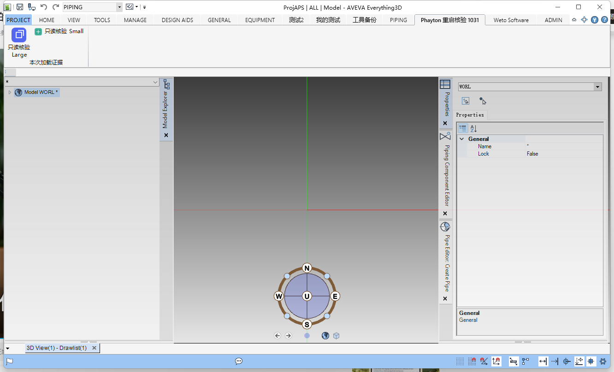

# Ribbon 部署后正常重启验证 · 2026-10-31

本轮已证明：在本机 E3D 2.1 的 APS / ALL / DESIGN 中，通过 v2 冻结文件更新与单个模块登记后，正常退出旧工程并启动新工程，新宿主实际显示本次 Ribbon 页签、分组、Large/Small 按钮图标与各自Tooltip。验收后已正常退出测试宿主、恢复唯一Design登记并停止本次后端；按钮Macro未点击，不能据此标记所有 Ribbon 或全产品验收完成。

本报告由独立子代理只读复核原始回执、文件/备份摘要及实际截图；宿主启动、部署与退出由主代理执行。此处未读取口令、启动脚本或账号资料；报告不收录任何秘密。原始证据根为 `F:\OneDrive\Documents\ChatGPT\PmlTwin\artifacts\ribbon-ui-live`。精选可发布证据逐字节复制至 [证据目录](ribbon-restart-2026-10-31.evidence/)，摘要及字节数见 [evidence-sha256.json](ribbon-restart-2026-10-31.evidence/evidence-sha256.json)；ticks保留原始JSON数字，未通过浮点解析重写。

## 范围及契约

目标安装入口为 `D:\AVEVA\Everything3D2.10\mon.exe`，模块进程为同目录 `des.exe`。用户明确本次 MDB 为 `/ALL`。测试UIC位于工作区独立文件 `F:\OneDrive\Documents\ChatGPT\PmlTwin\artifacts\ribbon-ui-live\Phayton.RibbonVerification.uic`，不是原生UIC替换。

本次先导入外部文档，再分别执行 v2 `file-update` 与 `registration-add`。登记仅针对 `D:\AVEVA\Everything3D2.10\DesignCustomization.xml`，新增条目名 `Phayton.RibbonVerification.20261031`，Path指向上述工作区UIC。没有以原生 Module、Project 或业务功能UIC作为覆盖目标。

本次实机部署由主代理直接调用本仓 HTTP v2 完成，未通过最终编辑 UI 点击提交。UI→同一后端的接线及交互烟测单独取证；两类证据不能描述成一次已完成的 UI 全程实机操作。

两份apply回执均保留 `state=deployed`、`workspace=saved`、`deployment=deployed` 及 `activation.reloadRequired=true/runtimeVerified=false`。这是正确的部署时事实；本报告的后续运行时证据独立追加，不篡改旧回执为“当时已加载”。失败或unknown不会自动重放；本轮两份实际apply均有确定deployed回执。

## 冻结预览及持久回执

| 项目 | 文件更新 | Design登记 |
|---|---|---|
| planId | `8f724d0a-7707-46ec-9326-2db0f652f84b` | `775e01d2-d6d0-400f-9f64-ec3a83870e13` |
| planDigest | `9f3c27a3b9113dc097f3c40cbbcca3b204310de84ffa71348ac83dd6d9bd6bd5` | `1abd18e8b2032d036ce4fa40daf59fbbaff5f0ae4a3ce0000d3657145e6a6584` |
| documentId | `79dcb3ff-d479-4573-8261-59336f66748f` | 同左 |
| expectedVersionId | `c3c4acbe-7a02-427c-b06f-b92c88b3b01b` | `0c0da47f-9bb3-46ff-9822-ceb1dccc1d13` |
| 项目摘要 | `2f8f3ea978affc3efcef923730de07b4edd4b70d39c32beaee218d3608f5ab9c` | 同左 |
| 到期UTC | 2026-10-31 15:40:03.7618278Z | 2026-10-31 15:40:22.0494282Z |
| 原始预览/结果 | `file-preview.json` / `file-result.json` | `registration-preview.json` / `registration-result.json` |

`project-validation.json` 为 `valid=true, issues=[]`。最终编辑项目见 `project-edited.json`，本次Tab文字为“Phayton 重启核验 1031”；它与准备阶段fixture的“Phayton 实机核验 1031”不同，应以实际部署项目、导出摘要和运行时截图为准。

## 字节、备份与未选清单

独立复核记录为 `review-hashes.json`；备份实际存在，摘要与冻结前字节一致。

| 文件 | before SHA256 | after SHA256 |
|---|---|---|
| 独立UIC，3792→3996字节 | `47ECDEE98ECB178B400F3B0D42D1C06A178842517D4F92E37ED0C187A37AF478` | `926D5E09603EFF5A1CAC8894F7B282692A4676F9274F0DEB2984A647E3A86825` |
| DesignCustomization.xml，1751→1922字节 | `78111FE80BB9781DEEC25E222B8ED731A95BFE78284DA0F2AB5D88995B046F5D` | `39E9599DE452AAAFF2C85484EA66BF14696A2E54FC0EFA6E82D777A4FAC2DCCE` |

UIC备份：`F:\OneDrive\Documents\ChatGPT\PmlTwin\artifacts\ribbon-ui-live\.ribbon-studio-backups\053e8f1e-0691-4a6f-87d8-6b0db5d87eb0\Phayton.RibbonVerification.uic`。

XML备份：`D:\AVEVA\Everything3D2.10\DesignCustomization.xml.RibbonStudio.6f5f7172-120b-4593-ab6b-3b9871f7dc75.bak`。

`manifests-before.json` / `manifests-after.json` 比较七份清单：只有Design改变；Draw、Isodraft、Monitor、Paragon、SchematicModelManager、Spooler六份SHA256逐项不变。此证据覆盖这些明确采集的清单，不扩展为整台机器全部文件不变。

恢复前必须重验当前目标仍等于本次after摘要；冲突则保留现场，禁止盲目覆盖。实际恢复结果见下方安全收尾；恢复字节不等于恢复后的宿主加载已重新验收。

## 正常重启与严格Host身份

两次 `launch.execute` 成功只报告入口创建，回执 `hostVerification=unverified`。工程身份分别由之后的独立通信CLI核验。

| 证据 | 重启前 | 重启后 |
|---|---|---|
| 启动operationId | `bbe4f705-ecd6-4854-b74e-0bd37b3cf4a9` | `e120695d-9d77-4c12-b8c3-5b77929c6478` |
| Monitor PID / UTC ticks | 128440 / 639290575555800173 | 131684 / 639290578611719303 |
| Design PID / UTC ticks | 115180 / 639290575598750292 | 127436 / 639290578642959920 |
| status Host时间UTC | 15:33:08.9503393Z | 15:38:20.8021481Z |
| Host | 0.3.4.2 / net48 / DESIGN | 0.3.4.2 / net48 / DESIGN |
| 两项查询协议 | FormQuery=1 / BoundedArrayRead=1 | FormQuery=1 / BoundedArrayRead=1 |
| 严格核验 | SessionSelected、Connected、TargetVerified均true | 三项均true |

`first-exit.json` 记录旧Design PID115180于15:37:20.2534286Z退出；主代理报告通过原生正常退出。之后新入口创建时间为15:37:41.1932242Z，严格Host身份时间为15:38:20.8021481Z。新旧模块PID及创建时刻均不同，不能把旧成功灯沿用到新会话。

原始文件：`launch-result-first.json`、`launch-result.json`、`sessions-first.json`、`sessions-after.json`、`status-first.json`、`status-after.json`。新会话窗口标题为 `ProjAPS | ALL | Model - AVEVA Everything3D`；Host返回专用管道 `yuzuha.pml.command.v1.pid-127436`，Expected/Host/SelectedSession的PID与创建时刻一致，ExpectedModel与Host.Model均为DESIGN，通信操作success=true/exitCode=0。

## 运行时外观证据

已目检 `aps-ribbon-selected.png`：实际E3D工程窗口选中“Phayton 重启核验 1031”，可见“本次加载证据”Group、带图标的“只读核验 Large”与“只读核验 Small”。Large为大图标及两行文字，Small为小图标及单行文字；这是宿主实际外观，不是设计器预览。

同名 `.uia.json` 记录四项均 `offscreen=false`：Group、两个Button与TabItem，类型分别为Group/Button/Button/TabItem。按钮矩形约61×71与116×21，补充实际大小形态证据；负屏幕坐标来自多显示器布局，不等于离屏。UIA控件尺寸不能替代PNG图像像素尺寸检查，也不证明点击动作执行。

另已分别目检 [Large Tooltip](ribbon-restart-2026-10-31.evidence/aps-tooltip-large.png)、[Small Tooltip](ribbon-restart-2026-10-31.evidence/aps-tooltip-small.png)：悬停对应按钮时均显示唯一标题 `PmlTwinRuntime20261031`，正文为“本次验收标记；仅查询已初始化会话变量。未经主代理明确批准不要点击。”，与实际项目一致。两图只证明悬停提示，不证明Macro已执行。另对实际部署UIC内两项Image解码读取PNG IHDR，分别为32×32与16×16，见 `review-icon-dimensions.json`；不凭屏幕缩放后的像素猜测。

发布证据仅使用定向宿主截图；最初 `aps-before.png` 包含非任务桌面，不纳入发布材料。

## 安全收尾与限制

`restore-result.json` 于15:41:50.3031606Z记录 `success=true/testHostExited=true/macroExecuted=false`。主代理正常退出新Design PID127436后，按精确备份与预览hash恢复唯一Design XML；恢复摘要等于原始 `78111FE80BB9781DEEC25E222B8ED731A95BFE78284DA0F2AB5D88995B046F5D`，七份清单全部逐项matches=true，未留下本次测试登记。工作区UIC、全部备份和回执保留，不删除用户资料。

`backend-cleanup.json` 记录本次Ribbon后端PID82720于15:42:24.4924454Z停止。主代理说明前两次因创建时间格式比较不一致而拒绝停止；改为精确DateTime ticks核对后才停止，没有使用PID单独决定终止目标。本报告保留最终停止回执，不把类型比较失败描述为宿主失败。

- Tooltip：两项均通过实际悬停截图复核。
- 按钮动作：notRun。项目文本为只读`q var !!PhaytonSession`，没有据此自动点击或宣称业务调用通过。
- 最终安全收尾：宿主退出、唯一测试登记恢复、七清单摘要复验及本次后端停止均已有回执；报告作者未停止宿主或后端。
- 本次仅覆盖本机E3D2.1 APS/ALL/DESIGN，不能推定AM、PDMS、E3D3.1.6、其他模块或CAF完成。未执行模型写入/保存作为验收步骤，未演练故障注入或恢复后加载。

验收契约详见 `openspec/changes/integrate-pmltwin-product-platform/features/ribbon-runtime-verification.md`。共享任务状态由主代理按最终证据更新，不能仅凭本报告勾选全产品7.3。
