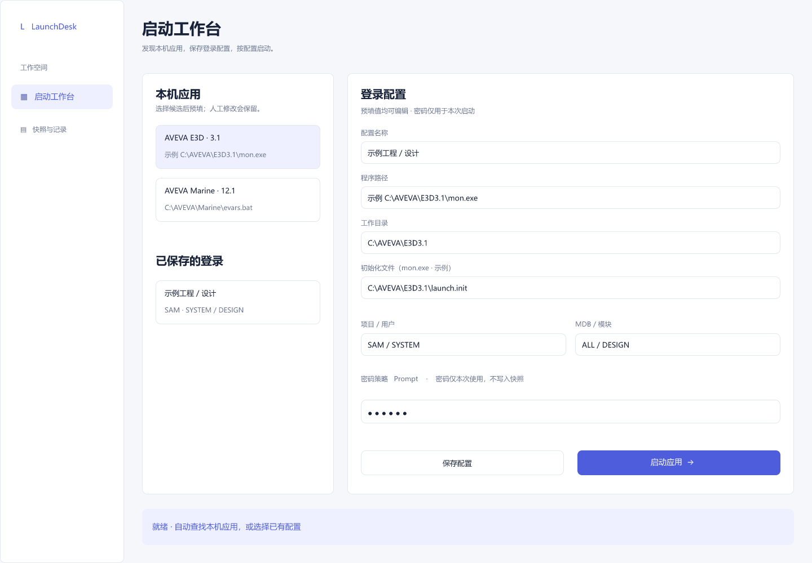

# 界面设计入口

文档站：[与作品集同源的DocFX主题](docfx-reading-theme.md)，含实际截图、原稿与回写边界；不属于产品WPF界面改动。

新方案：[远程工程与凭据FigCraft评审](remote-portable-review.md)，包括连接、失败、授权、导入、撤销、更新及控件状态。**尚未实现WPF**，必须按显式模板与实际DPI截图验收。旧工作台原稿保留如下。

下载[FigCraft可编辑原稿](launch-workbench.figcraft)，查看[主工作台预览](previews/workbench.png)和[状态预览](previews/states.png)。资源随文档站点复制，可直接下载或查看。

设计原稿是规划依据；实际运行截图、原视觉基线、资源来源与FlaUI交互结果记录在artifacts/frontend/delivery.md。布局差异以实际交付说明记录，不以设计预览代替运行验证。
