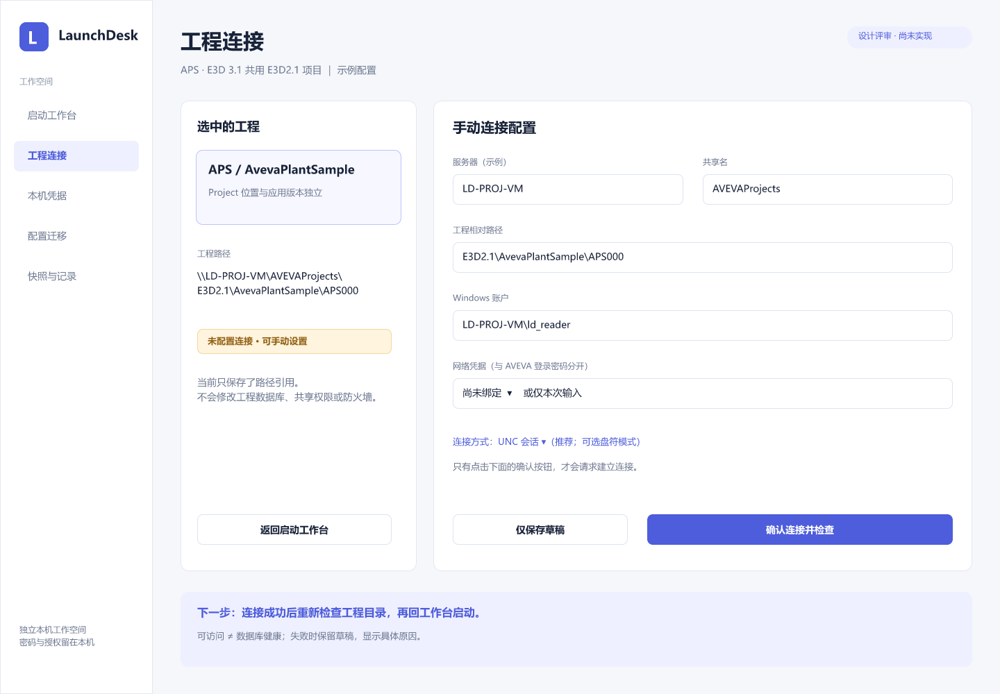

# 远程工程与凭据：FigCraft评审设计

2026-10-28。**原生设计，尚未实现WPF；不是程序运行截图。** 操作与前后端事实只维护在[八节方案](xref:remote-portable-review)，本页负责视觉交付与核对入口。

下载[可编辑FigCraft原稿](remote-portable-review.figcraft)。原有工作台页、组件和主色变量保留；新增“远程工程与凭据 · 评审稿”页127，独立文件不覆盖原图稿。由同一编辑者串行修改，避免多端覆盖。

| 场景 / 原生节点 | 预览与可操作边界 |
|---|---|
| 手动连接130 | [连接表单](previews/remote-portable/connection.png)：草稿不连网，确认才建立会话 |
| 盘符确认443 | [独立确认](previews/remote-portable/drive.png)：仅显式空闲P:，不覆盖已有映射 |
| 结果189 | [六种结果](previews/remote-portable/failures.png)：未配置、拒绝、1219、超时、未知、目录可读 |
| 授权249 | [勾选预览](previews/remote-portable/grants.png)：新增2、替换1；未选项不变 |
| 导入317 | [路径/冲突/未绑定](previews/remote-portable/import.png)：可只导入，不允许直接启动 |
| 撤销366 | [单项撤销](previews/remote-portable/revoke.png)：另外2项保留 |
| 更新影响411 | [撤销后的2项影响](previews/remote-portable/update-impact.png)：先预览，再输入新秘密 |
| 状态421 | [控件状态基线](previews/remote-portable/controls.png)：默认、焦点、错误、不可用 |

## 组件、变量与原型

Primary128、Secondary131、Disabled133均为组件，实例通过Label属性改文案；Primary绑定既有Accent变量。输入状态也使用组件。按钮44DIP高、圆角8；卡片圆角12、侧栏220DIP。主画板1440×1000；字体Microsoft YaHei UI；正文14、辅助12–13、标题30。主色#4E5DDB、正文#182238、辅助#6D7890、背景#F5F7FB、边框#E3E8F0。

连接确认→结果；失败→配置；连接方式→盘符确认浮层；导入后绑定→授权；授权→撤销；查看更新影响→浮层。原型只演示导航，按钮没有系统副作用，也不模拟保存成功。各图是评审状态，不能用原型跳转声称后台已经连接、授权或撤销。

## 从设计到WPF的验收契约（待实施）

| 控件/状态 | 实施前映射要求 | 后续验收证据 |
|---|---|---|
| 输入、下拉选择、路径框 | 明确TextBox/ComboBox/路径控件的Style与ControlTemplate，边框/圆角/内边距/箭头逐项映射 | 默认、焦点、展开、错误、只读、不可用截图；长UNC不遮挡，能横向查看/复制完整路径 |
| 按钮、复选框、列表 | 显式模板和资源字典；颜色由同一组token映射，键盘焦点可见 | 默认、悬停、按下、焦点、不可用；Tab顺序、勾选项与提交数量一致 |
| 连接与提交 | 等待时防重复提交；取消与OutcomeUnknown不显示伪成功 | 实际事件与OperationId/Revision回显日志，错误与下一步可见 |
| 浮层与影响列表 | 标题/主体/取消/确认层次与原稿一致；超长项目名可滚动，不隐藏确认范围 | 键盘关闭/取消不会提交，确认前可看全受影响项 |
| 布局与缩放 | 以DIP对照1440×1000主画板，100%/125%/150%DPI实际渲染，不使用默认控件外观作为替代 | 同尺寸设计与实际截图并排；关键尺寸误差≤2DIP、无裁切/遮挡，文案换行差异需说明并评审 |

本轮已导出并目视检查PNG，但尚无WPF截图、控件实现或DPI运行结果。不能把FigCraft渲染通过算作WPF视觉通过。完整后台失败覆盖见[方案⑦](../reviews/remote-portable.md#failures)，六种结果卡不是全部错误码的穷举界面。
