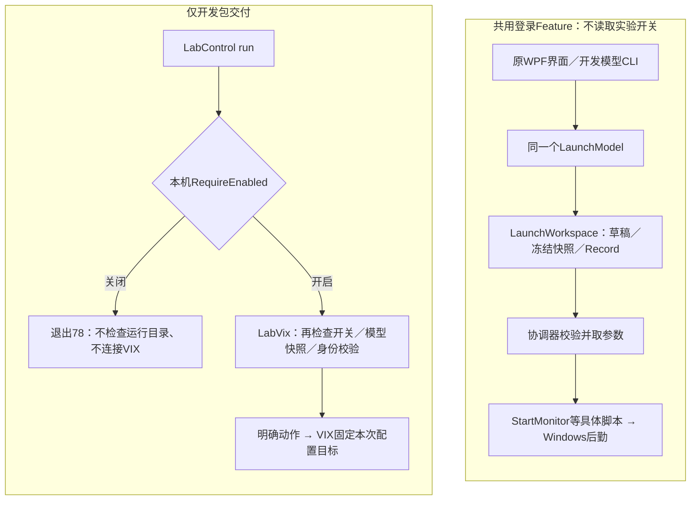
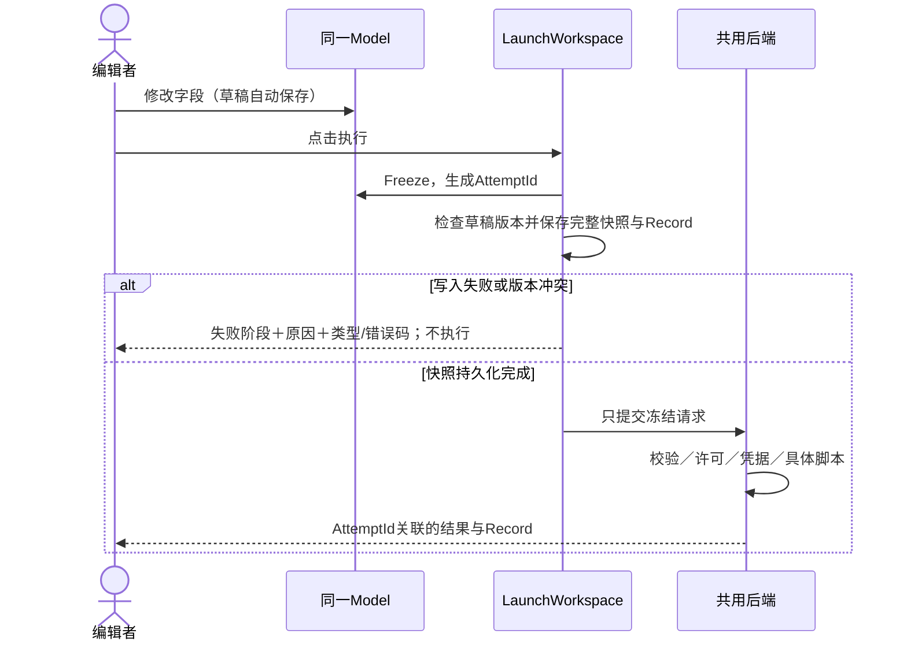

# 开发维护索引

**同一份模型与后端，两个交付包；本机开关只控制VM测试脚手架。** 本页八节说明当前实现。VM没有启动，普通远程不依赖实验包。完整模型方案见[八节功能说明](model-driven-review.md)。主题仍待视觉评审。

## ① 产品包与开发工具包

产品包包含原WPF界面与登录Feature；开发包包含模型CLI、LabControl与LabVix。两个包复用同一个[WorkspaceHost](../../src/LaunchDesk.Next.Bootstrap/WorkspaceHost.cs)和Domain/Application/Platform/Bootstrap程序集，打包时比较四个DLL的SHA256，拒绝分歧。没有再实现一套Monitor启动。VMware/VIX不随产品包加载或交付。

## ② 从界面顺着调用链找实现



产品入口：[CompositionRoot](../../src/LaunchDesk.Next.Desktop/Bootstrap/CompositionRoot.cs) → [WorkspaceHost](../../src/LaunchDesk.Next.Bootstrap/WorkspaceHost.cs) → [LaunchWorkspace](../../src/LaunchDesk.Next.Application/Features/LoginLaunch/LaunchWorkspace.cs) → [LoginLaunchCoordinator](../../src/LaunchDesk.Next.Application/Features/LoginLaunch/LoginLaunchCoordinator.cs) → [StartMonitor](../../src/LaunchDesk.Next.Application/Features/LoginLaunch/Scripts/StartMonitor.cs) → [WindowsProcessHost](../../src/LaunchDesk.Next.Platform/Processes/WindowsProcessHost.cs)。原XAML、控件、布局和样式均未改。

## ③ 同一Model如何双向编辑

[LaunchViewModel](../../src/LaunchDesk.Next.Desktop/Features/Launch/LaunchViewModel.cs)只转发字段到[LaunchModel](../../src/LaunchDesk.Next.Application/Features/LoginLaunch/LaunchModel.cs)，不再保留一份业务字段。模型的中性Changed事件使后端补丁也能刷新绑定，不依赖WPF通知接口。前端只保留候选/证据呈现、忙碌状态和错误显示。

[LaunchWorkspace](../../src/LaunchDesk.Next.Application/Features/LoginLaunch/LaunchWorkspace.cs)负责候选合并、保存、扫描记录、后端执行；业务校验集中在LaunchModelRules与LaunchValidation。每次模型字段变更自动保存draft.json。Generation冲突通过[文件租约与原子写入](../../src/LaunchDesk.Next.Platform/Storage/JsonDocumentStore.cs)拒绝覆盖；外部文件变更后需重新打开载入，尚无文件监视/自动合并。

## ④ 执行时怎样冻结并保存



快照保存在数据目录snapshots/<AttemptId>.json；端口原始字符串也保留，非法输入不会默默变成0。口令不进模型、快照或Log，仅保存本机凭据引用；敏感环境字段拒绝落盘。执行中继续编辑只影响下次；“保存配置”保留为命名配置操作，执行草稿不再要求另点一次保存。

## ⑤ 普通执行的失败返回

| 源码入口 | 成功与失败契约 |
|---|---|
| LaunchModel / LaunchModelRules | 非法端口保留原字符串，转换时报告字段错误；无前端业务准入 |
| LaunchWorkspace.FlushDraftAsync | 正常发布新Generation；外部版本冲突、文件/权限错误停止覆盖 |
| LaunchWorkspace.ExecuteAsync | 快照/Record/草稿冲突失败返回Rejected与具体阶段、原因、异常类型/HResult；不调用启动器 |
| LoginLaunchCoordinator.ExecuteSnapshotAsync | 共用原协调器/脚本；校验失败Rejected、无密码Cancelled；进程状态按既有契约返回 |
| 进程已创建或创建不确定 | NeedsVerification，不能标为“未执行”或自动重试；结果仍按AttemptId归档 |

原始输入、执行快照和List<Record>/NLog分工不同，不维护第二份业务规则。窗口或Monitor退出码也不能当作实际许可签出证明。

## ⑥ VM与许可怎么调，默认为什么不开启

许可服务器、端口、RULES及本机服务检查位于共用LaunchModel；VM路径、允许根、预期UUID/MAC、VIX路径、凭据文件引用、超时和证据目录位于[LabSettings](../../dev/RemoteProjectLab/LabSettings.cs)，示例为[lab.example.json](../../dev/RemoteProjectLab/lab.example.json)。不修改许可密钥、绑定或时间。

[DevelopmentSwitch.IsEnabled](../../dev/RemoteProjectLab/DevelopmentSwitch.cs)缺文件、损坏、false或机器/用户不匹配均关闭，不检测VMware或加载VIX。开关不随配置导出；Debug和环境变量不自动启用。以下仅是说明，本轮未执行启用或VM动作：

```text
LabControl status
LabControl fingerprint --model <lab.json>
LabControl enable --local
LabControl run --runtime <开发包目录> --model <lab.json> --confirm-target <核对的摘要> probe
LabControl disable --local
```

| 调用顺序／源码入口 | 失败返回 |
|---|---|
| [LabControl.Main](../../dev/RemoteProjectLab/LabControl.cs)：status → IsEnabled | 输出enabled/disabled，均0；关闭不是命令失败 |
| enable/disable → SetLocal | 只更新开关，不启动/关闭VM、不取消在途动作；成功0，InvalidOperationException为78，其他异常2 |
| run → RequireEnabled → 参数与runner路径 | 关闭先返回stderr/78；参数、文件与进程启动失败一般stderr/2；子进程退出码透传 |
| [LabVix.Main](../../dev/RemoteProjectLab/Host/LabVix.cs)：再次RequireEnabled → Read/SaveSnapshot → VerifyTarget → VIX | 异常stdout JSON stage/error＋1；目标身份/Host-only不符不连接VIX；成功通常0，底层guest-program非零映射2 |
| LabVix.Wait / Result | 超时表示结果未知，不自动重试；结果保存至Records和records.jsonl，记录失败提示人工核验；finally只释放资源，不承诺回滚或关机 |

## ⑦ Feature装配与分包边界

共用[WorkspaceHost](../../src/LaunchDesk.Next.Bootstrap/WorkspaceHost.cs)以FeatureId=login.launch提供装配和释放入口，产品窗口与开发CLI都使用它。开发VM入口在独立目录，不进入产品[slnx](../../LaunchDesk.Next.slnx)、注册或发布；没有实验包，登录Feature照常装配。具体CAF接口适配尚未实现。

[XML Addin驱动装配](addins.md)：features.json不再生成，运行时以Addins/*.addin.xml为准。没有有效声明，工厂不执行、功能不呈现；VM动作还要求独立本机授权。登录Addin随产品交付，保持原UI。

[架构测试](../../tests/LaunchDesk.Next.ArchitectureTests/ArchitectureTests.cs)覆盖新模型不依赖WPF、前端不依赖脚本/配置业务服务、产品不含开发类型或VIX导入。[打包入口](../../dev/RemoteProjectLab/Tool/Program.cs)从同一源码构建两包并核对共用DLL，不维护复制源码。此隔离防止误装配，不是安全沙箱。

## ⑧ 最短维护入口与证据

| 查什么 | 入口 |
|---|---|
| 两包命令与参数 | [README](../../dev/RemoteProjectLab/README.md)、[开发CLI](../../dev/RemoteProjectLab/Tool/Program.cs)、[Framework构建](../../dev/RemoteProjectLab/build.rsp) |
| 模型/快照回归 | [模型测试源码](../../tests/LaunchDesk.Next.UnitTests/Launch/ModelExecutionTests.cs)、[验证记录](../../artifacts/model-execution/verification.json)、[同源分包证明](../../artifacts/model-execution/manifest.json) |
| 旧FNF复现与厂商启动证据 | [历史源码说明](../../dev/RemoteProjectLab/History/README.md)、[八节验证报告](../reviews/licence-checkout.md)；History不编译、不分发、不作为第二启动器 |
| 环境历史与规格 | [G0/G1记录](../reviews/remote-project-lab-results.md)、[逐条OpenSpec](../../openspec/requirements.md) |
| 原LaunchDesk工具复制错误 | [只读调查](original-deploy-diagnostic.md)：空错误已确认，底层原因仍未恢复；未更新实际SeaGend |

TOML、拟议远程配置新界面、CAF宿主适配与真实VM参数回归尚未完成；不得据离线测试宣称这些已通过。文档图源是本页Mermaid，主题仍待视觉确认。
