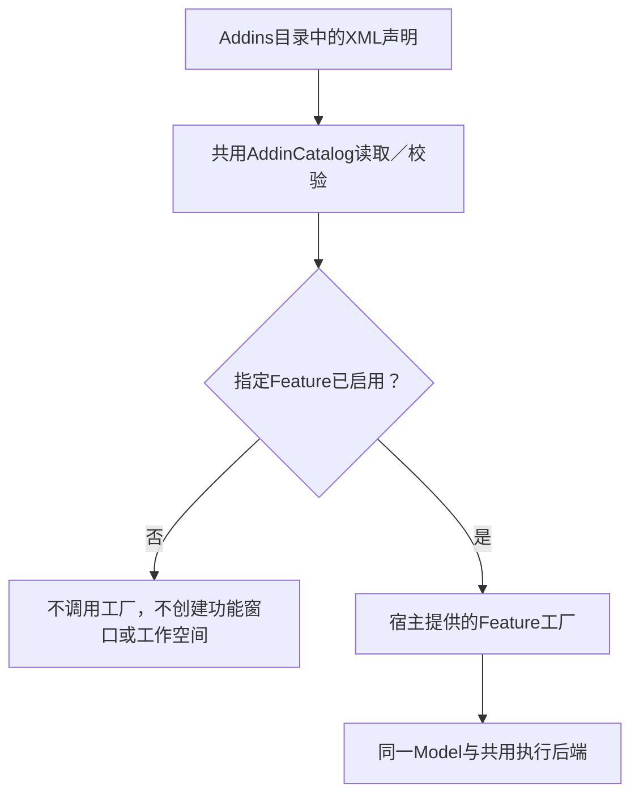

# Addin驱动的Feature装配

## ① 一句话说明

代码存在不代表功能启用：宿主只装配有效Addin声明的Feature。当前采用XML，使用.NET自带解析器，不安装新依赖；不同时维护TOML与XML两份启用事实。

## ② 清单长什么样

```xml
<?xml version="1.0" encoding="utf-8"?>
<Addin id="login.launch" enabled="true" contractVersion="1" />
```

源清单唯一维护在仓库addins目录；运行包读取自身Addins/*.addin.xml。产品只交付[登录Addin](../../addins/login.launch.addin.xml)，开发包额外交付[VM实验Addin](../../addins/development.remote-project-lab.addin.xml)。清单只声明身份、启用与契约版本，不存密码、VM路径或业务参数。

## ③ 怎么开关，什么时候生效

放入清单且enabled=true才装配；删掉清单、把扩展名改为.addin.xml.disabled或设为false均不装配。复制DLL不会自动注册。当前宿主在启动时装配，改清单后重启；没有运行中热卸载或自动终止在途动作。

当前产品只有登录窗口：不提供登录Addin时，不创建窗口或工作空间，正常退出0。登录Addin存在时保持原UI。开发CLI的features列出已启用声明，帮助只列出启用Feature的业务入口；未声明仍直接调用model命令时退出78。

## ④ 源码调用链



[AddinCatalog.Load/CreateIfEnabled](../../src/LaunchDesk.Next.Bootstrap/Addins/AddinCatalog.cs) → [CompositionRoot.CreateLoginWindow](../../src/LaunchDesk.Next.Desktop/Bootstrap/CompositionRoot.cs) → [WorkspaceHost](../../src/LaunchDesk.Next.Bootstrap/WorkspaceHost.cs)。CreateIfEnabled的关闭分支不调用工厂，WorkspaceHost也在创建文件前复查登录Addin；不靠控件Visibility隐藏已运行的功能。

## ⑤ VM功能为什么还有本机开关

VM Addin决定开发工具中是否注册/呈现该Feature；本机显式授权决定是否允许执行VM动作，作用不同。缺任一项都拒绝操作。启用Addin、打开宿主、编译、安装包或填写VM参数都不会自动启动VM。

[LabControl](../../dev/RemoteProjectLab/LabControl.cs)与[LabVix](../../dev/RemoteProjectLab/Host/LabVix.cs)在VIX动作前调用[AddinGate.RequireLab](../../dev/RemoteProjectLab/AddinGate.cs)。Framework工具通过同包开发CLI的addin-check复用唯一AddinCatalog，不另写一份XML解析或启用规则。Addin校验也不会把本机授权随清单迁移。

## ⑥ 失败怎么表达

| 情况 | 结果 |
|---|---|
| 没有目录/清单或enabled=false | Feature不装配；产品没有登录Feature时正常退出0 |
| 未注册却直接调用开发model功能 | stderr说明未注册的Feature，退出78，文件/工作空间不创建 |
| XML损坏、重复id、版本不支持、属性拼错 | 明确指出清单文件与原因，拒绝加载，不能最后一个文件覆盖前一个 |
| DTD、外部实体或超长文档 | 解析拒绝，不访问外部实体；不把XML当代码执行 |
| VM Addin宿主缺失/检查超时/关闭 | 工具拒绝，LabControl通常78，LabVix为JSON失败/1；不进入VIX动作 |

## ⑦ 两包如何避免两份事实

两包从同一addins源文件复制声明，复用同一Bootstrap/AddinCatalog与模型后端DLL。旧features.json不再生成；manifest只记录打包时看到的Addin与哈希，不作为运行时开关。产品不携带VM Addin或VM工具；即便开发代码被单独放在磁盘，没有Addin也不会由宿主注册。

这是已编译Feature的声明式装配：宿主明确提供工厂，不从XML任意加载程序集或执行脚本；具体CAF插件API与第三方DLL动态加载仍未实现。将来接CAF时复用这条身份/启用契约，业务模型和脚本仍只维护一份。

## ⑧ 如何验证与查找

[Addin测试](../../tests/LaunchDesk.Next.ArchitectureTests/AddinTests.cs)覆盖工厂存在但无清单不调用、false、不支持版本、重复id、DTD、拼错属性和停用扩展名；新分包还验证保留二进制而移除清单后没有功能入口。入口见[开发索引](INDEX.md)，参数/执行快照仍见[模型说明](model-driven-review.md)，规范见[AD-01](../../openspec/requirements.md)。本轮不修改UI样式，不启用本机授权或启动VM。
