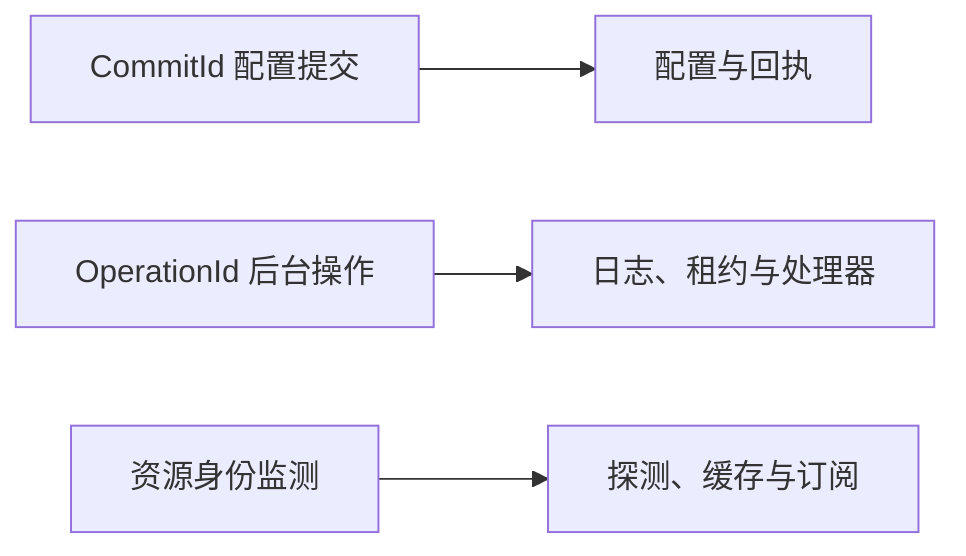

# SDD · 软件设计说明书（压缩初稿）

## 结构与接入

[接入状态](INDEX.md#范围与状态)。Kernel 放纯规则，Contracts 放端口/模型，UseCases 协调，Windows 执行副作用，Desktop 交互，Bootstrap 装配。

## 三条路径

冻结输入、修订和摘要防止旧计划误用；租约控制唯一执行，事实与回执分别记录观察和写入。秘密使用临时租约，Worker 认证原计划。恢复需确认；DevHost 只读，Aspire 可选。订阅由 Dispatcher 投影回 UI；测试不进入发布。外部资源不随编排结束。
