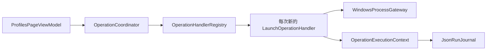

# 具体调用与释放规则

配合 [类索引](CLASS-DESIGN.md) 和 [接口契约](CONTRACTS.md) 审阅。协调器统一任务外壳，具体处理器负责业务动作；不是把所有代码移入另一个大类。

## 点击启动后由谁接手

| 顺序 | 类与方法 | 结果与约束 |
| --- | --- | --- |
| 1 | ProfilesPageViewModel → IOperationCommands.SubmitAsync | 请求只允许有限 Kind；输入稳定 ID 与修订，不允许任意脚本 |
| 2 | OperationCoordinator → IWorkspaceStore / IRunJournal.AcceptAsync | 冻结配置及确认计划、持久化意图，再接受任务；PlanRef 指向持久快照中的计划，不是页面对象 |
| 3 | OperationHandlerRegistry.Create | 唯一根据 Kind 选择具体 Handler 的位置，创建操作作用域与 HandlerLease |
| 4 | OperationExecutionContext 工厂 | 本次独立上下文；协调器不直接依赖或判断具体 Handler 的内部阶段 |
| 5 | LaunchOperationHandler.ExecuteAsync | 核对 Launch，捕获独立环境快照，构建计划，取得新鲜资源并短暂解析秘密后启动 |
| 6 | ObserveAsync → IOperationContext.ReportAsync | 处理器报告类型专属事实；上下文用 OperationStatePolicy 校验再按序号写入 |
| 7 | OperationProjectionService → ITaskQueries | 页面只拿投影和订阅，没有权限追加任务事件 |
| 8 | HandlerLease / Context 释放 | 终态或显式取消时由任务拥有者释放；不结束用户 AVEVA / VM |

Submit 的取消令牌只影响接受请求前的等待。接受后由协调器持有任务令牌，切页只取消订阅。取消已执行任务按事实核对；不能把 Cancelled 宣称为全部文件已撤销。进程事实提交前崩溃时保留不确定状态，不自动重放。

派发给 Handler 的请求是已受理快照的只读视图，包含其固定计划载荷；PlanRef 只作摘要关联，不能让 Handler 再去页面内存或可变工作空间取回另一份计划。重启后内部请求快照仅供核对，不因它存在就重新执行。

## 工具、变量与导入是不同请求

ToolPageViewModel 通过 IToolSourceCatalog 刷新来源，通过 IDeploymentPlanningService / IVariablePlanningService 只读预览。DeploymentPlanner / VariablePlanner 不执行写入；确认后才提交 Deploy / ApplyVariables。

Deploy 创建 DeliveryOperationHandler，取得目标租约并重验摘要，受控文件端口与 Worker 写入；计划的有限 Action 区分 Install / Recover / Rollback。恢复先 PreviewRecoveryAsync 读取原回执并生成新确认计划，不能拿旧 ID 直接重放。ApplyVariables 创建 VariableOperationHandler，比较旧值、新名与作用域后才应用。

ImportConfigurationHandler 仅提交已审阅的分享提案，不顺带启动、部署或应用变量。WorkspaceCatalogService 保存定义仍是普通配置用例，不能因为统一任务协议而强制把每个读取或编辑都排入后台队列。

## 防止协调器重新变成大类

OperationCoordinator 不依赖任何具体 Handler，不解析 mon 参数、不探测端口、不写文件。OperationHandlerRegistry 只装配工厂。OperationStatePolicy 只验证迁移。OperationExecutionContext 是唯一事实写入口，Handler 的参数只取得这个有限接口，不获得 IServiceProvider 或任意服务定位器。

IRunJournal 的内部请求载荷和部署字节回执不直接暴露给 UI。配置与秘密的跨存储提交遵循“新引用 → 保存配置 → 清理旧引用”；提交成功但清理旧引用失败，返回成功附带警告，不能诱发重复保存。

## 类级验收的落点

Coordinator 验证去重和生命周期；Registry 验证只有四类合法工厂；Context/Policy 验证顺序、非法迁移与窗口/会话区别；Handler 使用假进程/临时目录验副作用；Projection 验证切页不丢结果；ViewModel 与 ThemeResourceCatalog 结合视觉截图核对设计稿。
