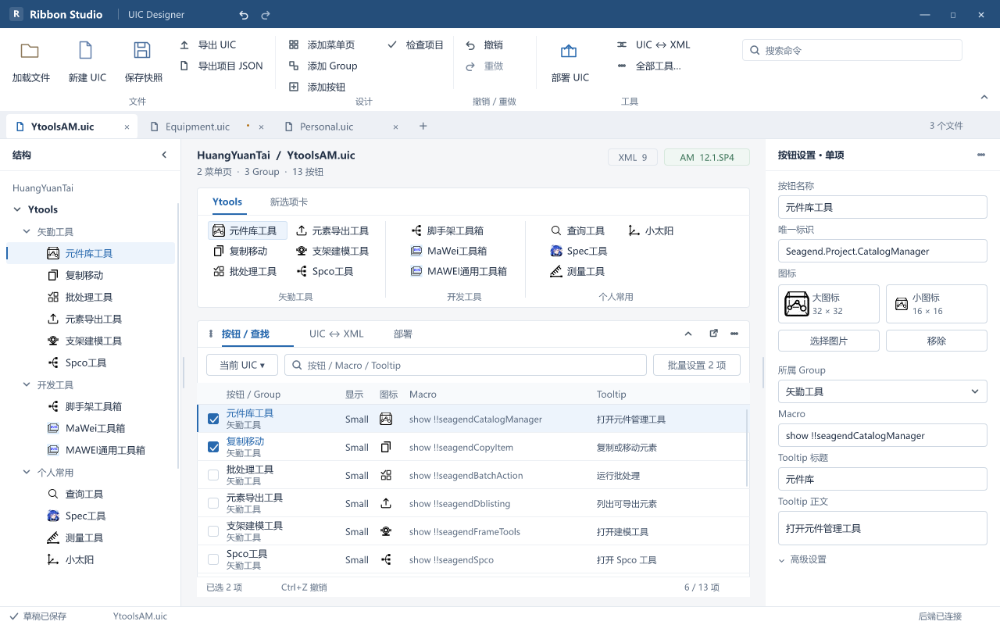

# Ribbon Studio · FigCraft 0.12

本版以完整桌面产品设计的标准统一工作区、工具浮窗与控件状态。沿用轻盈 Office 方向，保留顶部编辑器 Ribbon 和中央 UIC Ribbon 主视角，让结构、按钮功能和部署关系可以在同一工作区检查。

**这是设计与交互原型。** 画面中的文件、XML 数量、版本、时间和连接状态用于表达示例工况，没有连接后端读取实时数据。未修改 WPF、后端或真实 UIC/XML；图中的写入与撤销是状态跳转，不执行磁盘操作。

## 查看设计

- [原生可编辑源](../ribbon-studio-portfolio-0.12.figcraft)
- [按 Feature 浏览预览](index.html)
- [作品集展示板](case-study.png)
- [组件与状态](components.png)
- [审查合并记录](reviews/decisions.md)

源文件新增三页：「0.12 · 产品工作区」「0.12 · 组件与状态」「0.12 · 作品集」。0.11 全部原有内容保留。作品集展示板内的产品画面是原生图层，保持 1280×800 原尺寸，没有把整个界面替换成一张截图。

## 三个 Feature

### Editor：编辑器与 Ribbon

标题栏 → 完整命令 Ribbon → 浏览器式文件标签 → 左结构 / 中 UIC 预览 / 右属性。默认与紧凑主窗都完整展开；手动收起获得更多表格空间，窗口尺寸不变。更多命令用于找回未常显的入口。文档标签的关闭按钮与未保存标记分别占位。

中央预览使用本轮 YtoolsAM 样例的 13 个按钮，按三行纵向填充，不把第四项挤成第四行。左侧树、预览和表格活动行共同指向当前单项；窄树省略长名称，不缩小整套界面。

| 状态 | 预览 |
| --- | --- |
| 1280×800 默认完整 Ribbon | [main.png](main.png) / [2×](main@2x.png) |
| 1100×740 默认完整 Ribbon | [compact.png](compact.png) / [2×](compact@2x.png) |
| 1280×800 手动收起 | [collapsed.png](collapsed.png) / [2×](collapsed@2x.png) |
| 1100×740 手动收起 | [compactCollapsed.png](compactCollapsed.png) |
| 左右侧栏收起 | [rails.png](rails.png) |
| 从打开 UIC 开始 | [empty.png](empty.png) |
| 底部停靠预览 | [dock.png](dock.png) |

侧栏范围继续为左 148–320（默认 232 / 紧凑 168）、右 216–380（默认 300 / 紧凑 246），收起轨 48，分隔条 6，中心最小 480。源中展示离散状态，未实现连续拖动。

### Editing：按钮、Tooltip 与批量修改

表格单元格按整行垂直居中；名称和 Group 是 30 px 双行块，主窗行高为 36 px。图标列只放图标；Tooltip 列显示正文，右侧提供标题和正文两个字段。主窗属性标题标明「单项」，复选框只决定批量集合。

点击「批量设置」后，当前右侧区域变为字段选择面板。示例仅勾选 Tooltip 正文并改两个按钮，未勾选的名称、Group 和 Macro 保持原值；应用后可一步撤销与重做。跨文件搜索整体只读，定位到所属文件后编辑。

- [批量字段面板](bulk.png) → [应用后与撤销反馈](applied.png)
- [按钮 / 查找浮窗](find.png) → [跨文件只读定位](readonly.png)

### Registration & Deployment：登记与部署

UIC↔XML 页显示安装位置、版本徽标与来源，区分部署器与原生登记。同名 XML 用安装路径区分；原生项明确只读保护。已打开 UIC 的入口回到现有文档页。

部署预览逐项列出两个目标的完整路径、结构、关联数和备份位置。覆盖的是 UIC，原有模块 XML 引用保持不变；首次登记另行配置。原生文件复选框禁用，不进入写入预览。

- [登记观察](xml.png) / [官方原生保护](xmlNative.png)
- [部署预览](deploy.png) / [写入完成](success.png) / [校验失败](error.png)

## 原型路线与限制

主要可点击路线包括：主窗↔同尺寸收起、侧栏收起/恢复、底部工具切换、工具浮出/返回、停靠预览、批量应用/撤销、跨文件只读定位、原生登记详情和部署成功状态。

键盘示例：Ctrl+F1 在同尺寸主窗展开/收起；应用状态 Ctrl+Z 返回修改前，修改前 Ctrl+Y 返回应用状态。失败状态设有独立流起点。组件中的 Hover/Pressed 使用原生变体交互。

这些是静态状态原型：不会真正读取文件、导出、执行 Macro、写盘或维护撤销数据。并非所有可见菜单项都有业务动作；登记管理、全套文件切换、连续侧栏/浮窗拖动、布局持久化和业务性能由后续 WPF 集成验证。底部仍只有三个工具页，设计帧数量不代表程序要新增十九个窗口。

## 设计系统与验证

1 个 Light 集合、18 个颜色/间距变量、6 个文本样式、4 个变体集合、21 个原生组件及 1 个实际主窗实例。已有 2,275 个新增节点绑定颜色变量；间距变量提供统一取值。

[audit.json](audit.json) 审计通过：0.11 的 20,191 个节点缺失 0 / 修改 0；11 张原图保留；19 个顶层帧的直接内容越界 0；原型目标悬空 0。八个主窗状态均为 13 个预览按钮、每列最多三行、表格垂直中心误差不超过 0.5 px。边界审计不能代替对控件内部文字、滚动与运行时行为的人工检查，关键 PNG 已另行视觉检查。

三个 Feature 的评审由真实 Claude Code CLI 通过用户 CCSwitch 配置并发执行，仅启用 Read，不连接 FigCraft MCP。最终修改由一个写入者串行合并。审查意见并非全部照单采纳，取舍见 [decisions.md](reviews/decisions.md)。OpenSpec 位于 `openspec/changes/portfolio-polish-workspace/`，WPF 实施任务仍未勾选。
