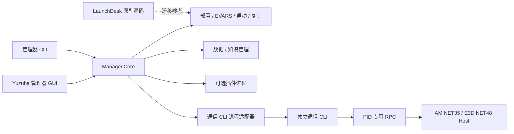

# Design

## Context

动机与能力范围见 [proposal.md](proposal.md)。本文件区分源码事实、用户已明确的方向和待实施设计；新增规范仍为候选，未 sync/archive。2026-10-29 取证基线与规划限制保留在 [evidence.json](evidence.json) 和 [verification.md](verification.md)；当前实施证据见 [implementation-verification.md](implementation-verification.md)，未完成交付见 [tasks.md](tasks.md)。候选状态不表示后端尚未实施，也不表示 GUI 或实机已经验收。

### 用户已明确的方向

- LaunchDesk 作为原型，启动和复制功能集成到 Yuzuha 管理器。
- 管理器同时提供 GUI 和 CLI，再触发另一个 CLI 完成 AVEVA 通信。
- 许可检测和虚拟机模拟作为可附加插件。
- 管理器负责运行文件部署、有效 EVARS 修改、用户数据与知识库导入检查。
- 最新授权允许当前模型自行完成设计；DeepSeek Harness 为可选渠道，不等待其凭据。FigCraft 负责可编辑设计与导出，按共享基础与独立 Feature 控制设计上下文。

### 现有源码与测试定位

下表为 2026-10-30 当前源码定位；外部原型条目仍标明来源基线，不能替代本次实施证据。原取证快照不改写。

| 范围 | 现有源码依据 | 可复用测试/证据 | 本次判断 |
| --- | --- | --- | --- |
| CLI | [兼容 NativeCliHost](../../../src/YuzuhaToolkit.Cli.Compatibility/NativeCliHost.cs)、[OperationCli](../../../src/PmlTwin.Phayton/OperationCli.cs)、[兼容目录](../../../src/YuzuhaToolkit.Cli.Compatibility/NativeOperationCatalog.cs)、[通信目录](../../../src/YuzuhaToolkit.Mcp.Core/CommunicationOperationCatalog.cs) | NativeCliCapabilityTests、DualModeCommandLineTests、CommunicationProtocolTests | 原生 46 项操作保留；进程协议仅组合通信与诊断，每次传目标身份 |
| 依赖边界 | [Mcp.Core.csproj](../../../src/YuzuhaToolkit.Mcp.Core/YuzuhaToolkit.Mcp.Core.csproj)、[Manager.Core.csproj](../../../src/YuzuhaToolkit.Manager.Core/YuzuhaToolkit.Manager.Core.csproj)、[Desktop.csproj](../../../src/YuzuhaToolkit.Desktop/YuzuhaToolkit.Desktop.csproj) | ArchitectureBoundaryTests、DesktopCliBoundaryTests | 管理内核不引用 RPC 实现；通信 Core 不引用管理/知识实现；Desktop 保留契约/登记类型引用，但通信走独立子进程 |
| 部署 | [RuntimeDeploymentService](../../../src/YuzuhaToolkit.Manager.Core/RuntimeDeploymentService.cs)、[PluginDeployment](../../../src/YuzuhaToolkit.Workspace/PluginDeployment.cs) | Manager.Tests、WorkspaceBehaviorTests、PmlDevelopmentWorkflowTests | 两种运行布局、冻结计划、哈希、暂存、备份及条件恢复已有隔离验证；完整安装包/实际更新另验收 |
| EVARS | [EvarsEditor](../../../src/YuzuhaToolkit.Manager.Core/EvarsEditor.cs)、[共享文本写入器](../../../src/Shared/EnvironmentTextEditor.cs)、[发现规则](../../../docs/aveva-discovery.md) | Manager.Tests、installer/tests | 编码/换行保持与有效文件选择已独立为管理服务；旧 Register-YuzuhaMcp 脚本仅保留历史兼容用途 |
| 引导 | [YuzuhaResolveRuntimePath](../../../PMLLIB/Bootstrap/YuzuhaResolveRuntimePath.pmlfnc)、[运行部署服务](../../../src/YuzuhaToolkit.Manager.Core/RuntimeDeploymentService.cs) | installer/tests、Manager.Tests | 开发源保留 PMLTRI token；部署副本的自定义根识别已有隔离验证，不代表真实产品已加载 |
| 启动 | [LaunchService](../../../src/YuzuhaToolkit.Workspace/LaunchService.cs)、[管理操作](../../../src/YuzuhaToolkit.Manager.Core/LaunchOperationCatalog.cs)、[旧入口转接](../../../src/YuzuhaToolkit.Cli.Compatibility/LaunchOperationCatalog.cs)、[LaunchDrafts](../../../src/YuzuhaToolkit.Workspace/LaunchDrafts.cs) | LaunchOperationTests、LaunchLifecycleTests、LaunchDraftTests、Manager.Tests | 配置与原型资料迁移、发现和启动复制已接管理服务；入口创建不等于工程登录或 Host 成功 |
| 会话与函数 | [SessionWorkbench](../../../src/YuzuhaToolkit.Desktop/SessionWorkbench.cs)、[桌面进程适配](../../../src/YuzuhaToolkit.Desktop/DesktopCliSession.cs)、[函数登记](../../../src/YuzuhaToolkit.Mcp.Core/PmlFunctionRegistry.cs) | DesktopSessionWorkflowTests、DesktopCliBoundaryTests、FunctionRegistryTests | 会话/对象/函数调用已走通信 CLI；登记、调用许可、人工信任与 AVEVA 实际加载分别表达，真实产品本轮未验收 |
| 用户数据 | [UserDataPaths](../../../src/YuzuhaToolkit.Workspace/UserDataPaths.cs)、[WorkspaceSettings](../../../src/YuzuhaToolkit.Workspace/WorkspaceSettings.cs) | UserDataManagementTests | 根目录、覆盖优先级、迁移哈希和保留旧源已有实现 |
| 知识 | [KnowledgeImportService](../../../src/YuzuhaToolkit.Manager.Core/KnowledgeImportService.cs)、[分层检查](../../../src/YuzuhaToolkit.Knowledge.Core/KnowledgeInspection.cs)、[版本库](../../../src/YuzuhaToolkit.Knowledge.Core/KnowledgeLibraries.cs)、[桌面管理](../../../src/YuzuhaToolkit.Desktop/MainWindow.UserData.xaml.cs) | Manager.Tests、UserDataManagementTests、[实施验证](implementation-verification.md#双版本真实资料) | 双路导入、结构/FTS/manifest/来源内容指纹已有后端验证；用户选定的双版本资料已在本机验证库导入，GUI 完整报告待接线 |
| LaunchDesk.Next | `../LaunchDesk.Next/src/.../LoginLaunchCoordinator.cs`、`.../Scripts/CheckAvevaLicence.cs`、`.../Bootstrap/Addins/AddinCatalog.cs` | 该仓库既有 Unit/Integration/ArchitectureTests | 当前 Feature 仅 LoginLaunch；许可检查位于启动协调器内；Addin 是显式功能开关，不能直接宣称通用插件平台 |
| LaunchDesk 旧版 | `D:/DeepSeek-Harness/202608-Inc/LaunchDesk-review/LaunchDesk.App/ToolOperations.cs`、`LaunchDesk.Update/UpdateEngine.cs` | [复制故障调查](../../../../LaunchDesk.Next/docs/development/original-deploy-diagnostic.md) | 旧版有复制、7z、回滚及 worker；异常只保留 Message，空错误问题尚需修复 |
| VM 实验 | `../LaunchDesk.Next/dev/RemoteProjectLab` | 历史实验记录与 DevelopmentSwitchChecks | 可作为 VMware 适配原型；不将实验开关/历史结果直接当正式插件或本次通过证据 |

2026-10-29 规划取证时，本机 E3D 2.1/3.1 的 `evars.init` 与 AM OH12.1.SP4 的 `evars.bat` 存在，连接服务为 0 个会话、知识服务为空库；这些是历史快照。此后已在工作区单独发布真实资料验证库，但默认目录与安装程序未切换。旧安装目录的 MCP 文件名与源码更新均不能证明本机已安装本轮管理器。

## Goals / Non-Goals

**Goals:**

1. 一套管理服务供 GUI/管理 CLI 使用；AVEVA 通信经过独立 CLI 进程。
2. 先打通无窗口管理与完整失败语义，再交付可操作界面。
3. 运行载荷、用户数据、事务记录各有归属，升级后可恢复。
4. 可选插件不成为基础功能的硬依赖。

**Non-Goals:**

本提案不扩展为 AVEVA 工程数据库克隆、许可服务改造或任意第三方代码市场；不恢复已禁用的 Yuzuha 独立 MCP 服务；不把本地资料批量发送给外部模型。FigCraft 使用自身 MCP 与此无关。

## Decisions

### D1：两个 CLI，一个管理内核

已建立 `YuzuhaToolkit.Manager.Core`、`YuzuhaToolkit.Manager.Cli`、`Communication.Contracts` 与 `Plugins.Contracts`；既有 WPF 会话/开发流程已转至通信进程，新管理页仍待逐页接线。通信适配器依赖 DTO 与进程接口，不引用 RPC Bridge。保留 `PmlTwin.Phayton.Cli.exe` 路径与通信契约；知识/管理实现已从通信 Core 分离，Workspace 仅保留公共服务引用。旧原生入口由 Cli.Compatibility 组合，兼容层不进入目标进程协议。

选择原因：用户明确要求独立通信 CLI；相较 GUI 直接调用 Bridge，进程边界使 CLI 版本、协议、崩溃和 stdout 语义可以单独检测。管理器 GUI 直接复用 Manager.Core，避免每次管理表单操作都再启动管理 CLI；GUI 和管理 CLI 仍使用同一服务和校验。

管理 CLI 已采用 `op list/describe/invoke`，当前操作组包括 `installation.*`、`evars.*`、`deployment.*`、`launch.*`、`launchdesk.*`、`copy.*`、`data.*`、`knowledge.*`、`connection.*`、`plugin.*`；实际 schema 与授权以 `op list/describe` 导出为准。函数登记/列表/许可/调用的 `pml.function.*` / `pml.functions.list` 仍属通信 CLI；GUI 本机登记与通信调用须在交接表明确归属，不能写成现有管理 CLI 操作。既有通信 ID、退出码和 `Success/Code/ErrorMessage/RequestId` 等字段保持兼容。

### D2：通信子进程使用有界 JSON 和逐次身份核验

通过 `ProcessStartInfo.ArgumentList` 启动明确路径的 CLI，固定工作目录，不经过 cmd/PowerShell 拼接命令。正常调用隐藏控制台；JSON 通过 stdin 传入，stdout 只承载结果，stderr 承载诊断。请求含协议版本、请求标识、操作、输入、目标 PID/启动时间/模块和 deadline；输出映射既有结果，并增加管理器关联标识。

先进行 capability/version 握手，检查清单与可执行文件身份；不把文件名匹配当可信版本。v1 使用每次调用一个进程，不加常驻守护进程。每次调用显式提供目标并重新核验，补上 manager 预期启动时间与通信侧发现时间的比对。版本、源文件或目标改变使旧计划和旧灯态失效。

设置独立的启动、握手、操作超时及输出上限；并发读取 stdout/stderr，避免死锁。进程未启动为 rejected；已向 AVEVA 发出且未获确定回执为 unknown。取消只能取消等待和适用的子进程；不能宣称 AVEVA 操作已回滚。写入与执行不自动重发。凭据引用或一次性 stdin/句柄在管理边界解析，秘密不进入管理/通信 CLI 的 argv、日志或计划。

### D3：部署模式和 EVARS 共用冻结事务

运行布局保留 `PMLLIB`、`PMLUI`、`runtime/profiles` 等既有相对结构：

| 模式 | 实际文件 | 环境登记 | 更新方式 |
| --- | --- | --- | --- |
| 独立目录复制 | 选定运行根中的受管载荷 | 指向该运行根 | 预览源/目标差异，暂存、备份后应用 |
| 安装目录内引用 | 管理器安装根下的受管运行载荷 | 直接指向该载荷 | 更新安装载荷后复核受影响产品，禁止清理用户数据 |

在使用默认布局时保留 `PmlTrigger` 引导 token；精确要求目录名为 `Yuzuha` 或其他名称时，生成并预览该副本的 bootstrap token 适配，执行前验证解析，不全局改动开发源。`Yuzuha` 环境变量继续表达 profile，`YuzuhaFramework` 表达 net35/net48。

安装发现核对用户所选根、入口与启动链，注册表两种视图可作为人工定位证据，不能替代管理操作必填的明确 roots。兼容单复数 EVAR 文件名；E3D 只选择有效 INIT，AM/PDMS 确认无适用 INIT 才选择 BAT。INIT 无权读取不等于不存在。EVARS 写入器已提取为独立管理服务，不依赖旧 MCP 注册；独立 MCP 服务仍禁用。

计划冻结安装身份、profile/framework、来源与目标哈希、环境文件原字节和托管段差异。事务顺序：验证 → 载荷暂存 → 原文件备份 → 载荷发布 → 环境段写入 → 重新读取核对 → 保存回执。失败回退本次已应用项；冲突或恢复失败保留现场并报 RecoveryRequired。托管段去重且位于有效初始化之后；遇提前 `exit /b` 等无法证明执行路径的情况拒绝盲目尾置。

沿用安装器管理标记、来源清单和用户目录保护。采用同一文件事务基础处理载荷/工具复制，但使用不同的受管清单策略；SQLite 只经知识导入或数据迁移的快照流程处理，不混入普通运行载荷。

### D4：吸收 LaunchDesk 功能，收敛到唯一启动与复制实现

以 LaunchDesk.Next 的安装发现、模块/工程读取、快照、启动脚本和观察记录作为启动实现原型；保留 Yuzuha 现有配置版本、历史与凭据引用。迁移有效行为到管理内核后，删除同一行为的重复实现与依赖，不把外部 LaunchDesk 窗口或旧 worker 作为最终用户必需项。

目录/文件/ZIP 从 Yuzuha 已有预览、哈希、暂存、备份能力迁移；旧 LaunchDesk 的 7z、复制选项和恢复交互按测试接入同一个事务核心。7z 依赖随可选格式能力正确交付，缺失时在计划阶段拒绝。避免把旧 `catch { Error=ex.Message; }` 原样带入；结果统一记录 code、phase、exceptionType、HResult（适用时）、message、requestId、logPath、rollbackStatus。

原型导入时只读取选定 LaunchDesk 的数据根和公开配置。现存旧版支持 portable.json/Data，而 Next 默认使用另一状态目录，不能只按默认 AppData 搜索，也不继承其他应用的凭据引用。迁移预览逐项映射；原数据保留。

启动状态拆分：计划有效 → 入口进程已创建 → 工程已观察到 → Host 已核验。许可预检从启动协调器的硬构造依赖中拆出；未启用插件时正常调用厂商启动链，用户显式配置强制预检才阻止未通过的启动。

### D5：灯态表现为可过期的测试证据

| 灯态 | 含义 | 显示信息 |
| --- | --- | --- |
| 灰 | 未测试或无运行会话 | 发现/启动入口 |
| 蓝 | 正在测试 | 当前阶段、耗时，可取消等待 |
| 黄 | 已发现但待核验、证据失效或能力不足 | 原因和下一步 |
| 绿 | 本次身份、管道、模块及所需协议均通过 | 测试时间、产品、工程、PID、Host 版本 |
| 红 | 本次明确失败 | 阶段、错误码、日志位置 |

颜色始终配文字，不使用独立颜色表达结果。许可灯与通信灯分开。产品卡片拥有安装状态，运行会话拥有通信状态；存在多个会话时列出并要求选择。目标退出、切换、部署更改立即失效，默认 30 秒后降为待复测；只刷新可达性不执行 PML。操作前仍逐次重验，绿灯不成为执行授权。

### D6：插件采用小契约与独立 worker

首版只支持随项目维护的附加包，不建设任意 DLL 自动扫描或通用工作流引擎。沿用显式 Addin 登记思想，清单含 id/version/contractVersion/entryPoint/capabilities/enabled；程序文件存在不自动激活。插件通过 `describe/invoke` 的版本化 JSON worker 暴露动作，GUI 与管理 CLI 使用同一发现列表，禁用插件不启动 worker。插件状态与数据存于独立 StateRoot/Plugins/<id>。

- **许可诊断插件**：移入现有 TCP/服务检查与可追溯诊断。分别记录 RMS、Rules、服务状态及具备证据时的 checkout；端口可达不是 checkout。插件缺失/停用时基础启动可用，显式预检策略另行展示。
- **虚拟机实验插件**：从 RemoteProjectLab 提取可测试的 VMware 适配，提供模拟 Host 和真实 VM 两类运行。计划冻结 VM/快照/产品/输出目录/有状态动作；运行前展示，按用户执行请求操作。崩溃或超时保留任务关联，不自动重跑快照。身份/许可配置仅在具体实验计划中作为明确动作，不在发现或插件加载时改变。

替代方案是将原实验代码和许可依赖全部静态装入基础管理器；这会把实验依赖和失败带入普通安装，故采用可选 worker 包。

### D7：用户目录保留已有约定，知识导入使用分层报告

继续使用 `UserDataPaths` 的优先级与 `.yuzuha-user-data.json` 标记；Knowledge、Apps、Projects、UserPmlLib、Exports 位于用户目录。配置修订、部署回执、日志、插件状态留在 StateRoot，旧设置可读并保留未知字段。管理器不会在每次启动时自动迁移；旧 knowledge 兼容路径保留到显式切换。

知识导入分两路：

1. **资料源**：选择角色、产品/版本、PMLLIB/PMLUI/WebHelp → 预览文件数/体积/目标 → 构建暂存索引 → 校验 → 登记。
2. **已有库**：选择 sqlite3 与可选 manifest → 只读检查 → 选择目标与来源映射 → 取得一致快照 → 暂存并校验 → 原子发布和登记。

同名不同内容默认冲突；WAL/SHM 或活动写入时拒绝裸复制，或使用明确支持的 SQLite 一致性备份，不复制不完整三件套。映射保留原 recordedPath，新增本机根映射；缺源可以显示降级可搜索，不能假报新鲜。保留 personal/project/experience 的既有保护与经验追加语义。

检查报告分级：文件/大小/锁 → integrity → 受支持 schemaVersion 与必要表 → 外键/来源-片段关系 → FTS 检索与一致性 → manifest/产品版本/根映射 → 内容指纹新鲜度 → 已知查询及片段回读抽样。每级独立状态和问题列表；原有 Check 的 ok 不能覆盖完整导入判断。现有文件数/总字节 freshness 只能标粗查；增加内容哈希后才提供强校验。

后端先用自建 PML/HTML 和合成 SQLite 矩阵验证；随后按用户选择分别导入 E3D 2.1 与 AM 12.1.SP4 资料，在工作区保留本机验证库、库身份与分层检查报告。默认活动库与已安装程序未切换，原文与索引正文不进入 Git、设计任务或发行包。真实资料检查与真实 AVEVA Host 执行是两类证据，不能相互替代。

### D8：按 Feature 独立设计，FigCraft 保留设计源

最新授权允许当前模型自行设计，不再以 DeepSeek 凭据就绪作为前置条件。DeepSeek 仍是可选设计渠道；既有 `dsh --version` 与隔离 `headless --help` 仅为 CLI 可用性证据，没有证明模型鉴权、网络或真实生成成功。

设计另存于 `docs/design/yuzuha-manager-features/`：`00-design-system` 共用基础，以及 `01-overview-connections`、`02-deployment`、`03-launch-profiles`、`04-tool-copy`、`05-knowledge`、`06-functions`、`07-user-data`、`08-plugins`、`09-records` 九个独立 Feature。各文件只含本 Feature 主画面、相关状态和交接信息，引用同一 tokens 版本，不再每次载入整个工作台设计。保留既有历史稿，不覆盖用户未保存窗口。

复用蓝色基线与主题变量。每个 Feature 独立交付 `.figcraft`、明/暗色可读预览和 handoff，列出状态、交互、GUI→管理 CLI/通信 CLI/本机服务的确切映射、授权、结果和实现差距；按适用范围覆盖未配置、加载、空、失败、冲突、部分恢复、unknown 与正常状态。函数 Feature 明确本机登记、调用许可、人工信任和目标实际加载的差别。窄窗、键盘焦点与返回后输入保留须有可检查约定。

验收布局后再接生产 WPF；设计稿和离线合成预览不能标为生产功能或实机通过。不同 AI 不得并行编辑 FigCraft，同一时刻仅一位编辑者；并行审阅只读导出与 handoff。知识原文、工程数据、主机配置和凭据不放入外部设计任务。

参考：[DeepSeek 官方 MCP 客户端](https://github.com/deepseek-ai/deepseek-harness/blob/master/packages/mcp/mcp-client/README.md)、[官方 MCP 子系统](https://github.com/deepseek-ai/deepseek-harness/blob/master/docs/subsystems/mcp.md)。

## Risks / Trade-offs

- 通信子进程增加启动耗时 → 先测实际冷/热耗时，保留每请求一个进程；只有明确性能证据再讨论持久会话。
- 兼容原生入口仍组合多类服务 → 用独立进程协议和依赖守卫保持通信边界；Desktop 保留 DTO/登记引用不能退回 RPC 直调。
- 更新安装目录内运行文件可能影响已启动 Host → 部署计划显示占用和受影响产品；文件登记完成不代表当前进程已加载新版本。
- 原 LaunchDesk 错误证据不完整 → 集成前修正空消息及阶段记录，隔离失败注入通过后才复用实际复制链。
- 大属性读取曾存在无响应边界 → 连通测试只做身份握手，不以重型对象查询测试链路；执行超时保持 unknown。
- 规划时 PATH 检查漏掉稳定 .NET 10 SDK，且沙箱曾影响 testhost 本机通信 → 已通过 global.json/脚本固定 10.0.302 并恢复隔离矩阵；历史超时不当作测试通过或业务失败。
- 产品实际兼容证据有限 → AM/NET35、E3D2.1/NET48、E3D3.1.6/NET48 分别记录 NotRun/Passed/Failed，不相互代替。

## Migration Plan

| 阶段 | 可审阅交付 | 完成条件 |
| --- | --- | --- |
| M0 | 本提案、能力场景、来源指纹、验证限制 | 规划校验通过，核心边界可审阅 |
| M1 | Manager.Core/CLI、通信进程适配器、兼容清单 | GUI 关闭可用；真实子进程合成 Host 测试含 unknown、PID 变化和日志分离 |
| M2 | 两种部署模式、独立 EVARS 服务、恢复记录 | 仅隔离目标完成备份、冲突、失败回退和引导解析；真实环境另出具体预览 |
| M3 | LaunchDesk 启动/复制能力迁移、灯态 | 无外部 LaunchDesk 窗口依赖，启动/登录/Host 状态分离，空 Error 修正 |
| M4 | 数据目录兼容、知识双路导入与检查 | 合成库正常/损坏/不兼容/缺源/同长度改动/WAL 冲突均有明确结果 |
| M5 | 共享基础＋独立 Feature FigCraft 与 WPF 接线 | 当前模型或可选 DeepSeek 设计；逐 Feature 源文件、明暗预览、tokens 和 handoff 可审阅；GUI/CLI 行为另验收 |
| M6 | 可选许可与 VM 插件、产品实机矩阵 | 未装插件仍可用；插件隔离及真实目标单独验收，最后生成安装预览和回退说明 |

每阶段单独可演示，任务按 1–2 小时左右的小交付拆分，不以阶段表承诺工期。回退使用既有发布与配置快照；不覆盖旧程序/数据后才寻求恢复。旧管理命令在兼容期转接，直到明确版本的迁移窗口结束。`contract.json` 的原有 ID 与状态按实测逐项更新，候选 spec 不自动同步或归档。
